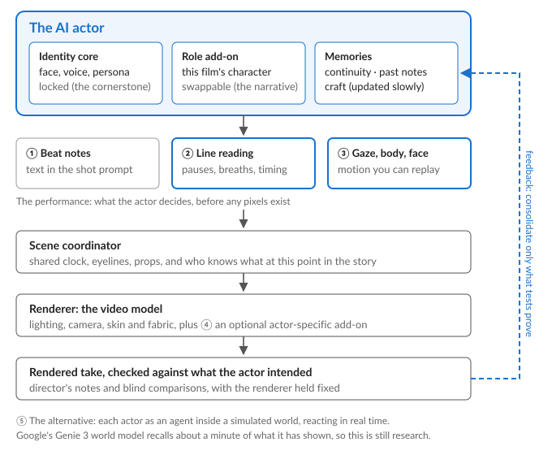

On June 12, 2026, an AI drama called 《被裁掉的女孩》 ("The Girl Who Got Cropped Out") launched on Douyin. It passed [200 million plays in about a month](https://m.163.com/dy/article/L3GHOTUN05198035.html). Its AI lead, Fang Taozi (方桃子), does not vanish between episodes. She has her own account, where she posts everyday life: making breakfast, buying flowers, working out. By early August it had [about 408,000 followers](https://www.163.com/dy/article/L3GG79130530WJIN.html). Her advertising rates were reported at 168,000 yuan for a video under 20 seconds and 258,000 yuan for one over a minute. Viewers [praised her skin texture, pores and small micro-expressions](https://ent.sina.cn/2026-07-23/detail-iniiuskx1526172.d.html), though others said they still could not get used to the "AI face."

Look behind the curtain, though, and Fang Taozi resembles a host from HBO's *Westworld* (2016–2022) more than a human star. In the show, android performers called hosts run scripted storylines, known as narratives or loops, and their memories are wiped so each loop starts fresh. Fang Taozi's off-screen life is written and run by a human team at the agency 我的影视, much as Westworld's narrative department scripts every charming habit of its hosts. Nobody has shown Fang Taozi herself learning anything between episodes.

## What makes a real actor

Before asking whether software can be a performer, we need a spec. A real actor keeps the same face, body and voice across productions. She has an off-screen self, distinct from her roles. She takes a director's notes. She has range: she plays very different people and stays recognizable. And she gets better with experience without turning into her last role.

Westworld maps neatly onto that spec. Every host has a written backstory anchored by a "cornerstone" memory. Bernard's cornerstone is the loss of his son Charlie, a tragic anchor Ford chose on purpose. In engineering terms, the backstory and cornerstone are the locked identity core and the off-screen persona. A narrative loop is a single role. Being reassigned to a new part is booking a new production. Today's AI characters fail this spec before lunch, because they do not even remember the previous shot.

## How AI dramas actually get made

An AI drama is not one giant generation. Production runs [shot by shot](https://cloud.tencent.com/developer/article/2752882). Teams split a script into episodes, scenes, shots and lines. For visual consistency they build a fixed "character pack" of prompts, reference images, a random seed and a LoRA. A LoRA is a small, detachable add-on file that nudges a large AI model toward a specific face or style without retraining the whole model. Then the crew generates storyboard images, turns them into clips with image-to-video tools, and finishes with voice, lip-sync and editing.

Inside each shot, one video model paints everyone at once: both characters, the light and the camera move. So today's "character" is an asset, like a costume plus a reference photo, not an agent making choices. Every cut is a Westworld memory wipe. Crews can work around this. Runway's Act-Two tutorial [records a separate performance for each character](https://help.runwayml.com/hc/en-us/articles/41748090660499-Creating-Multi-Character-Dialogues-with-Act-Two) and composites them into one scene. Even so, one industry analysis notes that AI realism has improved but [still suits the grand and spectacular better than the subtle](https://www.tmtpost.com/7891456.html).

## Five places to plug in an actor's brain

Think of the video model as an output stage. To have a real AI actor drive it, you need a clean signal path from the actor's "brain" to the frames. There are five possible connection points.

**1. Prompt notes.** The actor model writes beat-by-beat performance notes into each shot's prompt. It is cheap, like passing handwritten notes to a puppeteer, and it carries the weakest guarantee. "Less demonstrative" is a good acting choice but an unreliable command for a renderer.

**2. Voice first.** The actor decides the line reading, with its pauses, breaths and timing, and an audio-driven model animates the face and body from that soundtrack. Think of a radio play that drives the face. This is the most mature route for dialogue. MultiTalk (NeurIPS 2025) tackles [binding each audio stream to the right person](https://arxiv.org/abs/2505.22647) when two people talk. LPM 1.0 (April 2026) also generates [listening reactions such as nods and gaze shifts](https://the-decoder.com/new-ai-model-generates-45-minute-lip-synced-video-from-one-photo-and-runs-in-real-time/) from incoming audio. But matching a voice to a mouth is not deciding how to react. Unless someone plans the listener's reaction, the video model makes it up.

**3. Explicit motion.** The actor outputs body pose, facial motion and gaze, as if wearing a motion-capture suit. Wan2.2-Animate drives the body with [skeleton signals and the expression with implicit facial features](https://replicate.com/wan-video/wan-2.2-animate-replace/readme). X-Actor first generates [facial motion that carries no identity](https://arxiv.org/abs/2508.02944), then renders it onto a particular face. This is the only route where a performance can be replayed: keep the take fixed and move the camera. The cost is detail. Skeletons miss tears, wrinkles and fabric, and the renderer can alter the performance while filling them in.

**4. Actor-specific add-ons.** A small LoRA attached to the video model captures how this actor smiles or cries. The risk is calibrating your instrument to a single test fixture. It may learn "that scene," with its lighting, makeup and camera, instead of the actor. It can also bleed onto a co-star in the same frame.

**5. Agents in a world model.** A world model is an AI that generates an interactive world frame by frame, responding to what the agents in it do. Putting one actor agent per character inside such a world has the right shape for "acting is reacting." For now it is research: Google DeepMind's Genie 3 world model has [visual memory reaching back about one minute](https://deepmind.google/discover/blog/genie-3-a-new-frontier-for-world-models/).

The likely near-term design mixes the first three. The actor decides line readings plus timed gaze and body cues, silent reactions included. A scene coordinator handles timing, eyelines and who knows what. The crew picks a renderer for each scene, then checks the rendered take against what the actor intended. Film does not need real time: rehearse at rough quality, then render the final take offline.

Early prototypes hint at this workflow. Pika's Enact, a [research preview shown on November 18, 2026](https://www.orcarouter.ai/blog/pika-enact-research-preview) and not available to consumers, lets a director give spoken notes to AI actors. Notes are logged verbatim so later notes can refer back to them, and the team describes [locking a performance before changing the camera](https://www.theneuron.ai/newsletter/watch-pika-lets-you-direct-ai-actors-live). It has not yet shown a performance you can export and replay unchanged.

## Four memories every host needs

A good control interface does nothing if the controller resets every shot. An AI actor needs four separate memories.

**Continuity memory** tracks story time. Films are shot out of order. If scene 84 is generated before scene 12, the actor must still know the character's injuries, props and knowledge as of scene 12. That calls for a structured ledger, like a script supervisor's continuity binder, that separates facts about the world from what each character believes. A longer context window is not enough. (A context window is the span of recent text or data a model can hold in working memory at once.) Video models do have memory for faces: SlotMem keeps [a separate memory slot for each character](https://huggingface.co/papers/2607.15772), and Gloria reports keeping one character consistent in [videos over 10 minutes long](https://www.alphaxiv.org/abs/2603.29931). Neither tracks the plot.

**Episodic memory** holds past roles, directors' notes and co-stars, through searchable storage and retrieval. Retrieval means searching an external database for relevant records and feeding them back to the model when needed. That part is easy. But looking up an old note is not the same as acting better.

**Skill memory**, or craft, is the hard problem. It is closer to muscle memory than to a filing cabinet. Train an actor model on a villain and its default personality may shift: the method actor who cannot leave the role. Westworld built its plot on exactly this bug. Ford's "reveries" update gives hosts small gestures drawn from erased memories. That makes them more lifelike, and it lets old roles leak through. Peter Abernathy, who plays Dolores's father and was once cast as the villain of an old horror storyline, is [the first host to glitch](https://www.slashfilm.com/westworld-episode-8-spoiler-review). Maeve has run the Mariposa saloon for only about a year, despite implanted memories of ten. In a previous build she was a homesteader with a daughter, and the lab tech Felix has to tell her that her haunting "dreams" are [memories from that earlier build](https://www.highdefdigest.com/blog/?p=81329).

In the park, technicians tune each host's personality on an "attribute matrix" of traits scored from 0 to 20: bulk apperception, loyalty, empathy, aggression and more. Maeve talks the techs into lowering her loyalty and her pain and [maxing her bulk apperception at 20](https://www.hollywoodreporter.com//live-feed/westworld-key-moments-adversary-944342). Real models have nothing so tidy, but Anthropic's 2025 "persona vectors" research is a loose cousin. It found that fine-tuning can shift a language model's traits, and it showed ways to [monitor those shifts and steer against them during training](https://neurips.cc/virtual/2026/poster/152713). (Fine-tuning means running extra training on an existing model to adjust its behavior.)

A safer design borrows from the brain's "complementary learning systems." The hippocampus learns fast, the cortex learns slowly, and sleep consolidates lessons from one into the other. Engineers can read this as firmware versus configuration under strict version control. Freeze the identity core. Run each role in its own swappable add-on, as a sandbox. Merge craft updates into the core slowly, and only after blind regression tests show gains on scenes the actor has never seen.

**Persona memory** holds the off-screen self and the history with fans. The AI streamer Neuro-sama is the best precedent. Her developer, Vedal, has not published her architecture, though [fans assume a long-term memory store](https://www.reddit.com/r/NeuroSama/comments/1ityf5e/how_does_neurosama_work/mdyo2vb/). A University of Pennsylvania study of 15 months of her streams found that [audiences help create her authenticity](https://www.asc.upenn.edu/news-events/news/what-makes-ai-livestreamer-seem-real).

## Closing the feedback loop

To get better, a system needs a clean feedback loop. Acting offers three signals, and two of them are noisy.

Director notes are scarce but clean. Each note can become a controlled experiment: hold the script, camera and look fixed, and vary one parameter, such as how long she waits before answering. Audience metrics like watch time and completion rate are confounded by the script, editing, music and promotion. Close a control loop on watch time and you teach the actor shouting, tears and cliffhangers. Automated reward models are not ready either. A reward model is a separate program trained to grade another AI's output, so the system knows what to optimize. VideoReward, built by Kuaishou and university labs, scores [visual quality, motion quality and how well the video matches its text prompt](https://github.com/KlingAIResearch/VideoAlign). It does not score acting.

One more calibration rule: a fair test must hold the renderer version and the amount of human cherry-picking constant. Otherwise a sharper video model will pass for better acting.

## Why audiences connect

What usually breaks first in an AI performer is not the face. It is expressive identity: the habitual hesitation, the particular laugh, the lifelike half of Ford's reveries. Worse, many different AI characters drift toward the same attractive average face.

When continuity holds, attachment follows continuity more than species. In a Dutch study, 185 young women followed either a human or an AI influencer daily for a month, and [their one-sided bonds developed in similar ways](https://mediacat.uk/study-women-bond-with-ai-and-human-creators-in-the-same-way/amp/). The authors suggest that consistency, relatability and narrative may matter more than being human.

Still, the human behind the mask matters. The Chinese virtual idol group A-SOUL put its member Carol (珈乐) into "hibernation" on May 10, 2022, and [ended the contract with her performer on May 14](https://zh.moegirl.org.cn/User:%E8%8A%9D%E9%BA%BB%E6%B2%B9%E7%9F%BF/Sandbox), amid fan anger over how the performers were treated. Many fans had bonded with the person inside the avatar, too.

## The verdict, and a skeptic's test

Right now, a supervised "performer package" is feasible: a locked look and voice, external memories, separate role add-ons, and humans choosing the takes. In two to three years, reusable packages with real performance controls and tested learning are plausible. Five or more years out, an AI actor that learns largely on its own is plausible, but not assured.

Six bottlenecks stand in the way, hardest first:

1. Getting better without losing identity.
2. Staying the same performer while playing different people.
3. Keeping expressive identity.
4. Remembering story time and reacting to scene partners.
5. Separating the performance from the rendering.
6. Rights. SAG-AFTRA's 2026 contract lets producers use fully synthetic performers if they show ["significant additional value"](https://puck.news/hollywood/2026/5/sag-aftras-ai-deal-opens-door-to-synthetic-actors), and nobody has settled who owns the craft an AI actor learns.

What would convince a skeptic? Cast one AI actor in three productions of different genres, a comedy, a villain role and a quiet drama, with her identity locked. Blind viewers must recognize the same performer yet tell the three characters apart. Her work on held-out scenes must improve, judged blind. Afterward, no trace of the villain may remain in her baseline behavior. And when her scene partner changes timing, her reaction must change too.

Westworld's hosts woke up when old roles leaked into new ones. A real AI actor needs the reverse trick: keep every memory, and let only the craft leak through.

## How this article was made

GPT's Deep research surveyed the technical literature and the industry. Gemini drafted the article from a fact sheet. Claude checked the facts against their sources, edited the text and drew the diagram.

## Further reading

- Kong et al., [Let Them Talk: Audio-Driven Multi-Person Conversational Video Generation (MultiTalk)](https://arxiv.org/abs/2505.22647), NeurIPS 2025
- Zeng et al., [LPM 1.0: Video-based Character Performance Model](https://arxiv.org/abs/2604.07823), April 2026
- Zhang et al., [X-Actor: Emotional and Expressive Long-Range Portrait Acting from Audio](https://arxiv.org/abs/2508.02944), August 2025
- Tongyi Lab, [Wan-Animate: Unified Character Animation and Replacement](https://arxiv.org/abs/2509.14055), September 2025
- [SlotMem: Character-Addressable Internal Memory for Narrative Long Video Generation](https://huggingface.co/papers/2607.15772), July 2026
- Yang et al., [Gloria: Consistent Character Video Generation via Content Anchors](https://arxiv.org/abs/2603.29931), March 2026
- Google DeepMind, [Genie 3: A new frontier for world models](https://deepmind.google/discover/blog/genie-3-a-new-frontier-for-world-models/), August 2025
- Chen et al., [Persona Vectors: Monitoring and Controlling Character Traits in Language Models](https://arxiv.org/abs/2507.21509), 2025
- Liu et al., [Improving Video Generation with Human Feedback (VideoReward)](https://arxiv.org/abs/2501.13918), NeurIPS 2025
- Lingel and Wu, [What makes an AI livestreamer seem real?](https://www.asc.upenn.edu/news-events/news/what-makes-ai-livestreamer-seem-real), Annenberg School, University of Pennsylvania
