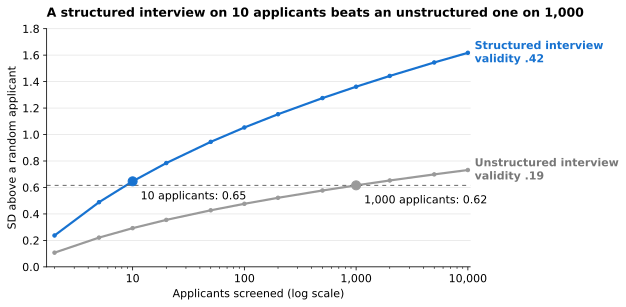
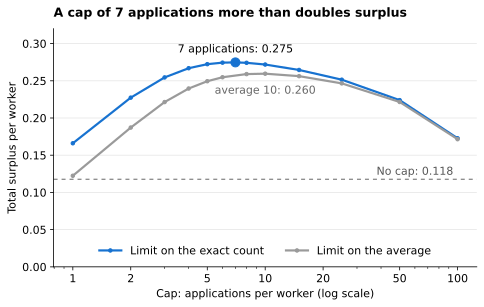

## Two thousand applications for two jobs

Applying for a job has become almost free, and the mathematics says that is the root of the problem, not the volume itself. In April 2025 a small software company advertised a junior programmer role and received more than 2,200 applications. It read every one by hand and hired two people.

That round is unusually well documented, but its shape is now common. Applicants use AI to produce a polished, tailored letter in seconds and send hundreds of them. Employers, buried, use AI to filter. Each side is responding sensibly to the other, and the result is a market where a perfect-looking application says very little.

To judge whether hiring still works, we need a yardstick. A simple one: **how much better is the person hired than someone picked at random from the applicants?** A process no better than a lottery has failed, however much effort went into it.

This article walks through what mathematics says about that question, from order statistics to game theory. It draws on two companion documents: a research report on the state of the theory, and a technical note with a simulation and a solved model. Both were checked by several independent reviewers, and where they found errors the numbers here are the corrected ones. Both are linked at the end, with the code.

Three findings carry most of the story:

1. **Measurement beats volume.** The quality of a hire depends far more on how well candidates are assessed than on how many apply.
2. **Cheap applications burn value without improving matches.** In a solved model, more than half of the surplus left after screening and entry costs goes on applications that change nothing.
3. **Better designs exist in pieces.** Matching theory offers proven components, but no one has proven that they work when assembled, and some of them conflict.

## The best of many: why validity beats volume

The quality of the best-scoring applicant grows only with the square root of the logarithm of the pool, while it grows in direct proportion to how good the test is. That one fact explains most of what follows.

Model each applicant's true quality $q$ as a standard normal variable: mean 0, standard deviation 1. The employer never sees $q$. It sees a score $s$, which is quality plus independent noise, scaled so that the correlation between $s$ and $q$ is $r$. Personnel psychologists call $r$ the **validity** of the assessment.

$$
s = r\,q + \sqrt{1-r^{2}}\;\varepsilon, \qquad \varepsilon \sim N(0,1)
$$

The employer hires whoever scores highest out of $N$. For jointly normal variables the best guess of $q$ given $s$ is $r s$, so the hire's expected quality is $r$ times the expected top score:

$$
\mathbb{E}[q_{\text{hire}}] = r\, m_N, \qquad m_N = \mathbb{E}\big[\max(Z_1,\dots,Z_N)\big] \approx \sqrt{2\ln N}
$$

A random applicant has expected quality 0, so $r\,m_N$ is exactly our yardstick, measured in standard deviations. The expected maximum $m_N$ grows painfully slowly: 1.54 for 10 applicants, 2.51 for 100, 3.24 for 1,000 and 3.85 for 10,000. Each tenfold increase in the pool adds less than the one before.

Validity, by contrast, multiplies everything. A large meta-analysis of hiring methods ([Sackett et al. 2022](https://www.siop.org/tip-article/is-cognitive-ability-the-best-predictor-of-job-performance)) puts structured interviews at .42, work samples at .33 and unstructured interviews at .19; years of experience manage .07. So a structured interview applied to 10 applicants (0.65 standard deviations above random) does as well as an unstructured one applied to 1,000 (0.62). Going from 100 to 1,000 applicants is cancelled entirely if validity falls by 23%.

An analogy from imaging: you are looking for the brightest star in a noisy exposure. Widening the field gives the real star more competition from noise spikes, and the brightest pixel is increasingly a fluke. Improving the signal-to-noise ratio is what actually finds the star.

Two refinements matter. First, **gaming**: if applicants can add an independent term $g$ to their score, validity falls to $r/\sqrt{1+\sigma^2}$, where $\sigma^2$ is the variance of $g$. What a larger pool then does depends on the tail of $g$. With Gaussian gaming the hire still improves with $N$, more slowly; with exponential tails the gain stops growing at a fixed level; with power-law tails it falls back towards zero, because the top scorer is increasingly just the best gamer.

Second, **heavy-tailed talent**. If a few people are worth many times the median, and that shows through the assessment, a larger pool is worth much more. In the technical note's simulation, growing a pool from 300 to 2,200 lifts the hire by 0.15 standard deviations when quality is normal, but by 0.74 with a fat-tailed (Student-$t$) distribution and 3.2 with a skewed (lognormal) one. When the screen sees only ranks, the same gains are 0.20 and 0.32. "Pool size buys little" is a statement about thin-tailed quality.

## Why a cover letter stopped meaning anything

A written application used to work as a costly signal, and AI removed the cost. The economics of this goes back to Michael Spence's 1973 model of job-market signalling, which won a Nobel prize.

Spence's insight is that a signal can be informative even if it has no direct value, provided it is **cheaper for the able to send**. A tailored, well-argued letter took hours, and it took fewer hours for someone who understood the job and could write. So a good letter separated candidates. If writing becomes cheap for everyone, and equally cheap, that separation disappears: everyone can afford the polished letter, so the polished letter tells you nothing.

What remains is what game theorists call **cheap talk**: costless statements from someone whose interests differ from yours. Every applicant wants the job regardless of how good they are, so costless text cannot rank them. It can still tell you which role someone fits, but not who is best.

The evidence arrived quickly. Two studies of Freelancer.com, a large online labour market, measured what happened when AI writing tools spread:

- **The signal weakened.** After the platform launched an AI proposal writer, the correlation between how tailored an application was and whether it got a callback fell by 51%; for offers it fell by 79%. Employers shifted their attention to review history instead ([Cui, Dias & Ye 2025](https://arxiv.org/abs/2509.25054)).
- **Selection got less meritocratic.** Before AI, a worker's written proposals correlated about 0.55 with estimated ability. In a model of the market where written applications carry no information, the top fifth of workers by ability are hired 19% less often and the bottom fifth 14% more, and average wages fall about 5% ([Galdin & Silbert 2025](https://arxiv.org/abs/2511.08785)).

This is not an argument against writing help as such. In an earlier experiment, grammar assistance raised hiring by 8% with no fall in employer satisfaction, because there, poor writing had been noise rather than signal. AI destroys the effort and interest a letter used to reveal; it can improve clarity.

The employer-side response creates a second problem: **monoculture**. When many firms use the same screening model, its errors are correlated, so the same people are rejected everywhere. In data on about four million applications screened by one vendor's algorithms, 4% of people who applied to ten positions were recommended for rejection at all ten, more than chance would predict ([Bommasani et al. 2026](https://arxiv.org/abs/2605.27371)). In theory, a shared evaluator makes extra applications pointless and freezes selection quality however many firms there are ([Peng & Garg 2024](https://arxiv.org/abs/2312.09841)); independent evaluators keep the "wisdom of crowds" but reward applying widely.

## Hundreds of applications: rational for one, wasteful for all

Sending hundreds of applications is the correct individual response to low odds and near-zero cost; the waste only appears when everyone does it. This is a textbook case of a collective-action problem, and the mathematics makes it precise.

Suppose each application yields an offer with probability $p$ and costs $c$, measured as a fraction of what the job is worth to you. With $m$ applications sent at random, the number of offers is approximately Poisson with mean $mp$, so your expected payoff is $1 - e^{-mp} - cm$. Setting the derivative to zero gives the best number of applications:

$$
m^{*} = \frac{1}{p}\,\ln\frac{p}{c}
$$

With a 1% offer rate and a cost of one ten-thousandth of the job's value, $m^*$ is about 460. Nothing irrational is needed to explain mass application: percent-level odds and nearly free applications are enough.

Now look at the market as a whole. A classic model ([Albrecht, Gautier & Vroman 2006](https://faculty.georgetown.edu/albrecht/agvfinalversion.pdf)) has equal numbers of workers and vacancies; each worker sends $a$ applications, and each vacancy can make only one offer. The share of workers who end up with a job is

$$
M(a) = 1 - \left[1 - \frac{1}{a}\left(1 - e^{-a}\right)\right]^{a}
$$

It is 0.632 with one application each, peaks at 0.681 with three, and falls back to 0.632 as applications go to infinity. More applications let workers diversify, but they also make vacancies send offers to people who take a job elsewhere. Notice the size, though: over-application costs about five percentage points of matches. The number of jobs filled is not where most of the damage is.

In one leading model, the damage is in **screening**. When reading an application costs the employer something and it cannot tell who is still available, cheap applications push the market into a regime where screening eats the employers' entire surplus. In that regime, a cap on the number of applications per person makes both workers and employers better off ([Arnosti, Johari & Kanoria 2021](https://business.columbia.edu/sites/default/files-efs/citation_file_upload/ssrn-2427960.pdf)).

A calibrated model of the US labour market points the same way. It attributes to cheaper job search between the late 1990s and the late 2010s a near doubling of applications per vacancy (from 20 to 38), a one-fifth fall in matching efficiency and a rise of about 70% in unemployment duration, with the losses concentrated on lower-productivity workers ([Bagga & Mann, 2026 draft](https://lfmann.github.io/files/papers/2026/bm_draft_10_15_26.pdf)).

## A model you can solve: applications as lottery tickets

In a small equilibrium model built for the technical note, making applications cheaper changes almost nothing except how many are sent, and the extra applications are pure waste. The model is deliberately simple so that every number can be checked.

**The setup.** There are two kinds of workers: 30% are highly productive (output 1 in a job), the rest less so (output 0.3). Every job pays the same wage, 0.5. Workers choose how many applications to send, at random, to vacancies. Each vacancy screens its pile in random order with a noisy pass/fail test that is right 80% of the time, offers the job to the first applicant who passes, and stops. Firms keep entering the market until expected profit is zero. Everything is solved exactly in the large-market limit and checked against a direct simulation of 200,000 workers.

**Why cheaper applications change nothing.** At each worker's optimum, total spending on applications obeys a simple identity, where $x$ is the worker's expected number of offers and $w$ the wage:

$$
c\,a = w\, x\, e^{-x}
$$

The right-hand side does not contain the cost $c$. Once vacancies are saturated with applications, halving $c$ roughly doubles the number of applications and leaves offers, hires and surplus where they were. In the model, as the cost per application falls from 0.005 to 0.0002, applications per vacancy rise from 32 to 809 while hires and total surplus do not move at three decimal places.

**Where the value goes.** At the baseline, workers send about 150 applications each, yet a vacancy screens only 2.7 of its roughly 160 on average; the rest are never read. Applications work like lottery tickets. Spending on them is 0.150 per worker against a net surplus of 0.118, so about 56% of the surplus remaining after screening and entry costs is burned on tickets.

**The AI shocks, one at a time.** Starting from a pre-AI baseline, making applications 20 times cheaper does almost nothing to surplus. Making screening cheaper helps. Making the test noisier is the damaging change: lowering its accuracy from 80% to 65% cuts total surplus by 37%. All three together leave surplus 19% below where it started.

**Caps and fees.** Two policies were compared across 16 parameter settings. A **cap** limits applications per person. A **fee** charges for each application and returns the money to all workers as an equal lump sum, so it only changes incentives, not total income.

- **Caps usually help, sometimes a lot.** A hard cap of 7 applications raises surplus at the baseline from 0.118 to 0.275, more than doubling it. Across settings, caps raised surplus in 13 or 14 of 16 cases, depending on whether they limit the exact count or the average.
- **Caps fail where self-selection matters.** A cap pushes everyone towards the same number of applications. Where firms can only break even because the productive workers apply more than others, a cap destroys that sorting; in three settings no cap helped at all.
- **The rebated fee was the robust instrument.** It raised surplus in all 16 settings, with both kinds of worker better off, and beat the best cap in 12. It works because each type still chooses its own rate, and the rebate returns the money. Where neither type applies more than the other, the cap was slightly better, by at most 0.006.

The model is stylized: one round, one offer per vacancy, a single wage, illustrative parameters. Its numbers show mechanisms, not magnitudes for any real labour market.

## What a better market could look like

Matching theory, the mathematics behind the 2012 Nobel prize to Alvin Roth and Lloyd Shapley, offers proven building blocks, but also proven limits on what any design can promise.

**Stable matching.** American medical residents have been placed by a central clearinghouse for decades. Its core is **deferred acceptance** (Gale and Shapley, 1962). Each applicant proposes to their favourite remaining program; each program tentatively holds the best proposals it has received and rejects the rest; rejected applicants propose to their next choice; repeat until no one is rejected. The result is *stable*: no applicant and program would both rather be with each other than with their assigned partners. It is also safe for applicants to rank their true preferences. But no stable mechanism can make truth-telling safe for both sides at once ([Roth 1982](https://stanford.edu/~alroth/papers/1982_MOR_EconomicsOfMatching.pdf)).

**Wages, and a link to optimal transport.** When pay is negotiable, the stable outcomes are exactly the solutions of a linear program that maximizes total match value, and the stable wages are its dual prices (Shapley and Shubik, 1971). Add random individual tastes and the equilibrium becomes an entropy-regularized optimal transport problem, solvable by Sinkhorn iterations; the computation is not the bottleneck.

**Scarce signals.** Many residency specialties now give each applicant a small budget of "signals" to mark their top programs. A signal is credible precisely because it is scarce. In otolaryngology, programs offered interviews to 58% of applicants who signalled them and 14% of those who did not. Five signals barely changed how many applications people sent; twenty-five cut them by 37%. At that point a signal budget works like a cap.

**Few interviews can be enough.** In the worst case, reaching a stable matching requires communication that grows like $n^2$, so essentially everyone must assess everyone. With realistic structure, a shared quality score plus individual fit, it does not: interview protocols reach a suitably defined stability with about two interviews per applicant ([Babaioff, Gil & Romm 2026](https://arxiv.org/abs/2602.20358)) or a number growing only like $(\log n)^2$.

**No free lunch.** If both a worker's cost and an employer's value are private, no mechanism can be efficient, truthful and voluntary without an outside subsidy (Myerson and Satterthwaite, 1983). With both values uniform on $[0, 1]$, efficient trade is worth 1/6 on average, but the information rents needed to make people reveal their values add up to at least 1/3.

**The pieces do not simply stack.** Capping the length of rank lists, for example, destroys the truthfulness and stability that deferred acceptance guarantees: with two workers who both prefer job A, a one-job limit can leave a worker and a job unmatched even though each would prefer the other. Field results are sobering too. A randomized trial of deferred acceptance for 9,577 US Army officers made the process fairer (a third less justified envy) but did not improve performance ratings or promotion ([Davis, Greenberg & Jones 2023](https://www.nber.org/papers/w31612)).

The design the theory points to is layered: verified evidence instead of prose, scarce signals, caps or rebated fees to ration attention, published bars so applicants can aim, a few structured interviews, and clearing with wages built in. Each layer has supporting results under its own assumptions. No one has proven the whole pipeline works.

## A real hiring round, run through the math

In the one well-documented case examined, a late work sample did most of the selecting, and the huge applicant pool added little. The case is 37signals, a small software company, hiring a junior programmer in spring 2025.

The company published unusually much about the process. The [posting](https://jobs.rubyonrails.org/jobs/2120-junior-rails-programmer-37signals) gave a fixed salary of \$145,849 in every location, a fixed deadline, and a promise that people, not software, would read every application, with AI-sounding ones discarded. The stages were: human review of every application, a phone screen, a short call with a programmer, a 6–8 hour take-home exercise modelled on real work, and a final interview about the candidate's solution. The opening drew more than 2,200 applications ([founder's post](https://world.hey.com/dhh/we-ll-always-need-junior-programmers-69ddb4a1)). Across this and a parallel senior search, about 75 people took the exercise and four were hired, two of them juniors ([company podcast](https://www.buzzsprout.com/2260539/17663283/transcript)).

Treat it as two rounds of the selection model above. Round one scores everyone on prose, with an assumed validity of .19. Round two gives a shortlist the work sample and interview, with an assumed combined validity of .47, and the best two are hired. The junior shortlist size was not published, so three sizes are shown.

| Design | Hire quality (SD above a random applicant) | Same, if the prose screen tells nothing |
| --- | --- | --- |
| Prose screen only, top 2 of 2,200 | 0.63 | 0 |
| Prose screen, then 10 work samples | 1.13 | 0.60 |
| Prose screen, then 35 work samples | 1.34 | 0.89 |
| Prose screen, then 75 work samples | 1.43 | 1.04 |
| Work sample for all 2,200 | 1.56 | 1.56 |
| Pool of only 300, then 35 work samples | 1.19 | 0.89 |

Three things stand out:

- **The work sample does the selecting.** With 35 work samples the process reaches about 86% of what testing all 2,200 people would.
- **The flood bought little.** Shrinking the pool from 2,200 to 300 costs only about 0.15 standard deviations of hire quality.
- **A wide shortlist is insurance against AI-written prose.** If letters carried no information at all, 75 work samples would still deliver 1.04; the 10 the posting originally planned would deliver 0.60.

The validities here are textbook averages, not measurements of this firm, and the model assumes normal quality. Under the heavy-tailed alternatives of the earlier section, the pool would matter more.

## If you are applying right now

The same mathematics, read from the applicant's chair, favours raising the odds of each application over sending more of them, and spreading applications across employers that judge differently. These are conditional rules of thumb, not guarantees; the figures come from the selection model above unless a source is given.

**Expect noise, and don't read much into a rejection.** If an employer calls back the top 5% of its pool on a prose-quality screen (validity .19), a candidate at the 90th percentile of true quality is called back only 7.7% of the time. Being turned away is the normal outcome even for strong candidates, so broad application is rational.

**Raise the odds of each application.** One application with success probability $p_1$ is worth $k$ ordinary applications with probability $p_0$ when they give the same chance of at least one success:

$$
k = \frac{\ln(1-p_1)}{\ln(1-p_0)}
$$

In one applicant-tracking vendor's data on 38 million applications, 40% of referred candidates reached an interview against 3% of cold applicants ([Ashby](https://www.ashbyhq.com/talent-trends-report/reports/referrals)), which makes one referral worth about 17 cold applications. That is a raw comparison, not a causal estimate: referred candidates differ from others. Firm-level studies agree on the direction.

**Spread across different screens.** If half of the scoring noise is shared across employers, for instance because they use the same screening software, the chance that a good candidate gets no callback from 25 applications rises from 17% to 55%. Varying company size, sector and route in (direct, referral, recruiter) diversifies that risk; more of the same does not.

**If you are strong, seek processes that test the work.** Moving from a prose screen to a work sample plus interview doubles the callback odds of a candidate two standard deviations above the pool (9.9% to 21.2%) and lowers those of an average candidate (4.7% to 3.1%). Openings that test real work early are where ability is most likely to be seen. Smaller pools help too: the chance of topping a pool falls steeply with its size.

**Lead with what can be checked, and use AI for clarity, not content.** Tailored prose no longer sets you apart. Public work, test results and contactable referees do. Making true content clearer with AI is supported by the evidence; inventing content is what work samples and in-person rounds exist to catch.

**Apply early where a posting may close.** On one technical-jobs platform the median posting stayed open about a week and almost half of all applications went to postings less than 48 hours old ([Davis & Samaniego de la Parra 2024](https://econpapers.repec.org/RePEc:nbr:nberwo:32320)). Under a fixed deadline with batch review, timing does not matter.

The irony is that each of these is sensible for one person, and that followed by everyone, they are exactly the congestion described above.

## How sure are we?

The arithmetic and the classical theorems are solid; the magnitudes from the solved model are illustrations; a complete better design is still a conjecture.

**Solid.** The order-statistics results are exact under their assumptions and were reproduced independently. The classical theorems (stability, the impossibility of two-sided truthfulness, Myerson–Satterthwaite) are decades old, though each holds only under its stated conditions, and those conditions matter.

**Model-dependent.** The equilibrium model's numbers, such as "56% burned" or "a cap doubles surplus", belong to one stylized parameterization. The case-study figures rest on assumed validities. Several of the 2025–2026 results cited are recent preprints that have not finished peer review.

**Open.**

- No one has proven that a full pipeline of signals, interviews and clearing keeps its guarantees when the layers are stacked.
- No equilibrium model yet has AI on both sides: applicants optimizing text against employers' learned screens.
- Whether the main waste is screening (firms reading applications from people who are no longer available) or application spending (lottery tickets) is an empirical question.

One more caution about how this was produced. The report and the technical note went through several rounds of independent review by other AI systems, and those reviews caught real mistakes: a referral figure taken from a secondary source that had misquoted the original, two equilibria a numerical solver had missed, and a number of theorems quoted without their conditions. All were corrected before this article. Fresh eyes found errors every round, which is a reason to treat any single number here as checkable, not final.

## Full report, technical note and code

- [Full research report: Designing better job matching systems](files/job-matching-report.pdf) (PDF, 17 pages): the state of the theory, with every source.
- [Three-page summary](files/job-matching-summary.pdf) (PDF)
- [Technical note: a fully specified simulation and a solved equilibrium model](files/job-matching-technical-note.pdf) (PDF, 6 pages)
- [Case study: one real hiring round (37signals, 2025)](files/job-matching-case-study.pdf) (PDF, 2 pages)
- Code (Python 3 with NumPy and SciPy): [selection_sim.py](files/code/selection_sim.py) for the selection simulation, [equilibrium_model.py](files/code/equilibrium_model.py) for the equilibrium model, and [run_equilibrium_v2.py](files/code/run_equilibrium_v2.py) to reproduce the model's tables.

## Further reading

**Selection and signalling**

- [Sackett et al. (2022), revised validity estimates for hiring methods, via SIOP](https://www.siop.org/tip-article/is-cognitive-ability-the-best-predictor-of-job-performance)
- [Galdin & Silbert (2025), Making Talk Cheap: Generative AI and Labor Market Signaling](https://arxiv.org/abs/2511.08785)
- [Cui, Dias & Ye (2025), Signaling in the Age of AI: Evidence from Cover Letters](https://arxiv.org/abs/2509.25054)
- [Peng & Garg (2024), Monoculture in Matching Markets](https://arxiv.org/abs/2312.09841)
- [Bommasani et al. (2026), Algorithmic Monocultures in Hiring](https://arxiv.org/abs/2605.27371)

**Congestion and search**

- [Albrecht, Gautier & Vroman (2006), Equilibrium Directed Search with Multiple Applications](https://faculty.georgetown.edu/albrecht/agvfinalversion.pdf)
- [Arnosti, Johari & Kanoria (2021), Managing Congestion in Matching Markets](https://business.columbia.edu/sites/default/files-efs/citation_file_upload/ssrn-2427960.pdf)
- [Bagga & Mann (2026 draft), Job Search Technology, Selection, and Hiring](https://lfmann.github.io/files/papers/2026/bm_draft_10_15_26.pdf)
- [Davis & Samaniego de la Parra (2024), Application Flows](https://econpapers.repec.org/RePEc:nbr:nberwo:32320)

**Matching theory and design**

- [Roth (1982), The Economics of Matching: Stability and Incentives](https://stanford.edu/~alroth/papers/1982_MOR_EconomicsOfMatching.pdf)
- [Myerson & Satterthwaite (1983), Efficient Mechanisms for Bilateral Trading](https://www.cs.princeton.edu/courses/archive/spr10/cos444/papers/myerson_satterthwaite83.pdf)
- [Babaioff, Gil & Romm (2026), Efficient Interview Scheduling for Stable Matching](https://arxiv.org/abs/2602.20358)
- [Davis, Greenberg & Jones (2023), the US Army deferred-acceptance trial](https://www.nber.org/papers/w31612)
- [White et al. (2026), residency preference signalling](http://journals.stfm.org/familymedicine/2026/november-december/white-0251/)

**The case and the applicant's view**

- [37signals junior programmer posting (2025)](https://jobs.rubyonrails.org/jobs/2120-junior-rails-programmer-37signals), [founder's post](https://world.hey.com/dhh/we-ll-always-need-junior-programmers-69ddb4a1) and [podcast transcript](https://www.buzzsprout.com/2260539/17663283/transcript)
- [Ashby talent trends report: referrals](https://www.ashbyhq.com/talent-trends-report/reports/referrals)
