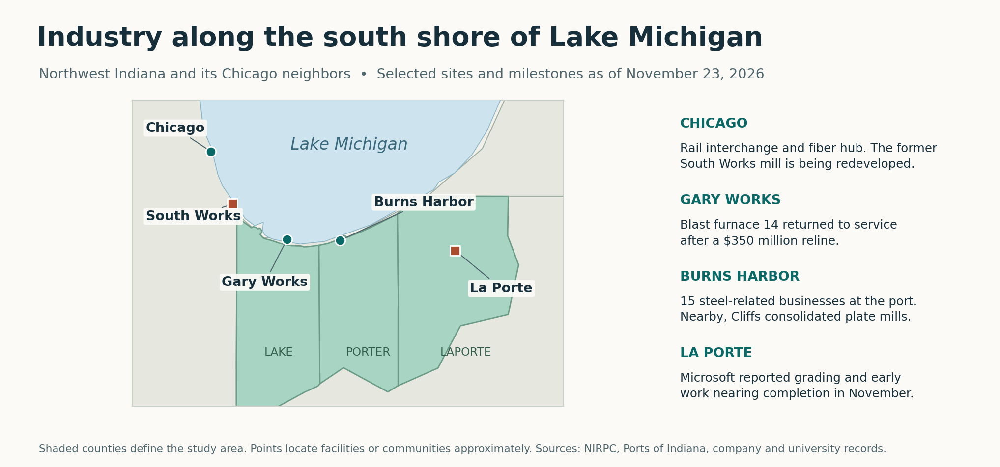
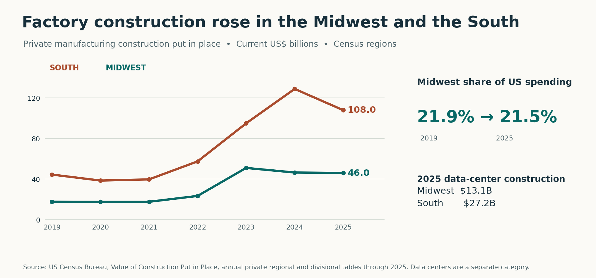
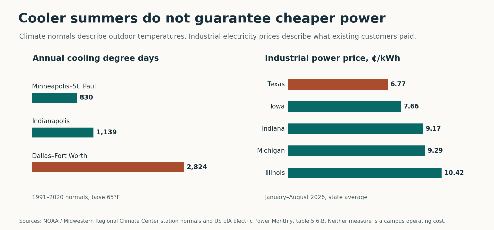
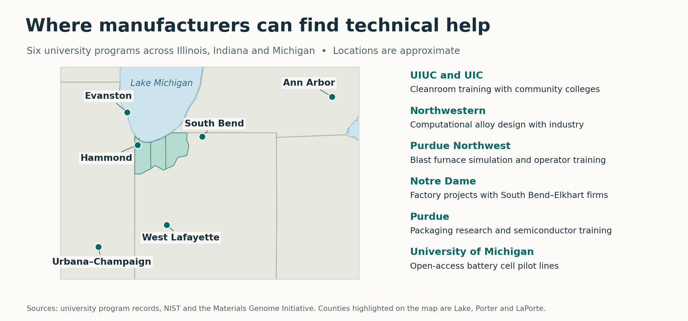
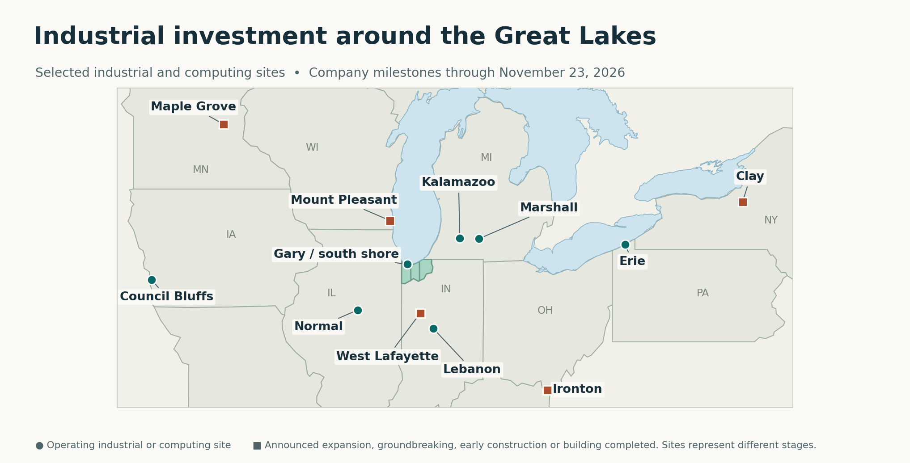

[Download the full illustrated article (PDF)](files/northwest-indiana-industrial-outlook.pdf).

On the drive from West Lafayette to Indianapolis, I keep seeing new factories going up. In Lebanon, Lilly opened a genetic-medicine plant in May. Back in West Lafayette, SK hynix broke ground in August on a roughly $4 billion facility to package high-bandwidth memory for AI. Two companies, two different reasons to build in Indiana. Lilly pointed to demand for medicines. SK hynix chose to work alongside Purdue.

<a href="https://investor.lilly.com/news-releases/news-release-details/lilly-commits-additional-45-billion-across-indiana-manufacturing">Lilly in Lebanon</a> · <a href="https://www.purdue.edu/newsroom/2026/Q3/sk-hynix-breaks-ground-on-4-billion-advanced-packaging-production-facility-in-purdue-research-park/">Purdue and SK hynix</a>

That drive made me wonder whether the southern Great Lakes might be due for an industrial revival. The place I would watch most closely is a different stretch of Indiana, where Lake, Porter and LaPorte counties meet Chicago’s freight network and the industrial towns of southern Michigan. By 2035, I expect parts of that corridor to gain work modernizing mills, building equipment and supplying new plants. Cooler weather helps some projects. The strongest reason to build here is that firms can find a customer, an experienced crew and a route to market in the same place.

<figure>
  
  <figcaption>The three shaded counties are the focus. West Lafayette and Lebanon lie farther south on I-65. Pin locations are approximate.</figcaption>
</figure>

<a href="https://www.in.gov/nirpc/files/2025-NWI-CEDS-FINAL.pdf">Northwest Indiana regional strategy</a> · <a href="https://epa.illinois.gov/topics/community-relations/sites/iqmp.html">South Works redevelopment</a> · <a href="https://www.portsofindiana.com/locations/burns-harbor/">Ports of Indiana</a> · <a href="https://local.microsoft.com/blog/la-porte-public-meeting-recap/">La Porte construction update</a>

A single season on the lakefront illustrates what a revival might look like. In September, U.S. Steel returned Gary Works’ No. 14 blast furnace to service after a $350 million reline. A few miles away, Cleveland-Cliffs had idled its Gary plate-finishing line and one of its two Burns Harbor plate mills. Cliffs said it could maintain its steel output after consolidation. These two decisions show what a modernization cycle looks like for the people who work in it.

<a href="https://www.ussteel.com/es/prereleases/-/blogs/u-s-steel-completes-350-million-gary-works-blast-furnace-14-reline-returns-furnace-to-service?_com_liferay_blogs_web_portlet_BlogsPortlet_redirect=https%3A%2F%2Fwww.ussteel.com%3A443%2Fes%2Fprereleases%3Fp_p_id%3Dcom_liferay_blogs_web_portlet_BlogsPortlet%26p_p_lifecycle%3D0%26p_p_state%3Dnormal%26p_p_mode%3Dview%26_com_liferay_blogs_web_portlet_BlogsPortlet_cur%3D1%26_com_liferay_blogs_web_portlet_BlogsPortlet_delta%3D20%26p_r_p_resetCur%3Dtrue%26p_r_p_categoryId%3D20794604">U.S. Steel</a> · <a href="https://www.clevelandcliffs.com/investors/sec-filings/all-sec-filings/content/0000764065-26-000115/clf-20260930.htm">Cleveland-Cliffs Q3 filing</a>

The furnace also exposes a climate risk that has little to do with air temperature. A reline extends the life of coal-based ironmaking. An electric-arc mill can use scrap and electricity, and its emissions depend partly on the power supply. Hyundai’s Louisiana electric-arc steel project is the kind of competitor Gary will face for automotive business. The lakefront’s advantage in moving iron ore is worth more to some production processes than to others.

<a href="https://www.eia.gov/outlooks/ieo/IIF_industrial/">EIA steelmaking routes</a> · <a href="https://org-htwo.hyundai.com/en/worldwide/press-releases/article/hyundai-steel-hpls-electric-arc-furnace-groundbreaking">Louisiana project</a>

## Where the freight network earns its keep

Northwest Indiana’s primary-metals cluster had 15,876 jobs in 2023, down 1,687 from 2018. Its share of local employment was still roughly 23 times the national share. The regional planning commission also estimated that the cluster bought $14.5 billion of goods and services in 2023, with 48.2% purchased inside the region. That is a roughly $7 billion local market for suppliers even after five years of job losses. Growing that share would give towns beyond the mill gates a stake in the next investment.

<a href="https://www.in.gov/nirpc/files/2025-NWI-CEDS-FINAL.pdf">Regional economic strategy</a> · <a href="https://www.in.gov/nirpc/files/NIRPC-CEDS-Appendix-060425.pdf">NIRPC and Lightcast estimates</a>

At Burns Harbor, the port hosts 15 steel-related businesses and a short-line railroad with 12 miles of track. A mill can receive bulk inputs by water and ship coils or fabricated parts by rail or truck. I-80/94 connects the south shore to Chicago and Michigan. Metropolitan Chicago handles roughly a quarter of US freight trains and half of intermodal trains. The same density creates queues at junctions and crossings. For a parts supplier, dependable delivery to an assembly plant is worth more than a rail line drawn past its property.

<a href="https://www.portsofindiana.com/locations/burns-harbor/">Ports of Indiana</a> · <a href="https://cmap.illinois.gov/regional-plan/goals/recommendation/maintain-the-regions-status-as-north-americas-freight-hub/">Chicago Metropolitan Agency for Planning</a> · <a href="https://www.in.gov/indot/files/Indiana-Multimodal-Freight-and-Mobility-Plan_Report.pdf">INDOT freight plan</a>

<figure>
  
  <figcaption>National share gives the construction boom a denominator. Census Midwest and South totals cover their full official regions. The lakeside portions of Pennsylvania and New York are counted in the Northeast.</figcaption>
</figure>

<a href="https://www.census.gov/construction/c30/pdf/division.pdf">Census manufacturing table</a> · <a href="https://www.census.gov/construction/c30/pdf/region.pdf">Census regional data centers</a>

The Midwest’s annual factory construction spending rose from $17.6 billion in 2019 to $46.0 billion in 2025. Its national share edged from 21.9% to 21.5%. The South built $108.0 billion in 2025, and also spent about twice as much as the Midwest on data-center construction. These are current-dollar construction outlays. Payroll gives a different view. From 2019 to 2025, Indiana’s factory jobs fell from 541,100 to 517,300, while Lafayette–West Lafayette rose from 20,400 to 21,200. My drive picked up something real in a place doing better than its state.

<a href="https://www.census.gov/construction/c30/pdf/division.pdf">Census construction</a> · <a href="https://fred.stlouisfed.org/data/SMU18000003000000001A">BLS Indiana</a> · <a href="https://fred.stlouisfed.org/data/SMU18292003000000001A">BLS Lafayette metro</a>

The contrast also shows up in production. From 2019 to 2025, inflation-adjusted manufacturing output increased about 2.7% in Ohio and 35.9% in Texas, according to BEA. Texas factory payroll grew about 8.9% over the same period. Southern competition has customers, capital and established industrial networks of its own.

<a href="https://fred.stlouisfed.org/data/OHMANRGSP">BEA Ohio</a> · <a href="https://fred.stlouisfed.org/data/TXMANRGSP">BEA Texas</a> · <a href="https://fred.stlouisfed.org/data/SMU48000003000000001A">BLS Texas</a>

## What cooler air is worth to a data center

Berkeley Lab’s June 2026 update puts data centers at 11.8% of US electricity use in its central 2030 scenario, with a range of 9.5% to 15.3%. Some of that demand is already taking physical form in La Porte, where Microsoft reported in November that grading and early work were nearing completion. A server runs hot in January. A cool day can let the operator reject heat outdoors with less mechanical refrigeration. Dry-bulb temperature matters for dry coolers. Wet-bulb temperature, which reflects humidity, matters for evaporative systems. A closed liquid loop can carry heat away from the chips, but the heat still has to leave the building. The relevant weather record is the hours a particular design can run efficiently and the hottest hours it must survive.

<a href="https://eta-publications.lbl.gov/publications/united-states-data-center-energy-2025">Berkeley Lab 2030 scenarios</a> · <a href="https://local.microsoft.com/blog/la-porte-public-meeting-recap/">La Porte work update</a> · <a href="https://eta-publications.lbl.gov/sites/default/files/2024-12/lbnl-2024-united-states-data-center-energy-usage-report.pdf?_sp=448601bd-cfca-4aae-9399-e17fdc012ee8&amp;stream=top">Berkeley Lab cooling models</a> · <a href="https://blogs.microsoft.com/blog/2026/06/24/inside-microsofts-two-decade-push-to-cut-water-intensity-while-scaling-for-growth/">Microsoft cooling designs</a>

<figure>
  
  <figcaption>The climate numbers are weather-station normals for 1991–2020. Cooling degree days characterize regional heat exposure. They cannot predict server-room electricity use or replace an hourly engineering model.</figcaption>
</figure>

<a href="https://www.ncei.noaa.gov/access/services/data/v1?dataset=normals-monthly-1991-2020&amp;endDate=9996-12-31&amp;format=pdf&amp;startDate=0001-01-01&amp;stations=USW00093819">NOAA Indianapolis</a> · <a href="https://www.ncei.noaa.gov/access/services/data/v1?dataset=normals-monthly-1991-2020&amp;endDate=9996-12-31&amp;format=pdf&amp;startDate=0001-01-01&amp;stations=USW00003927">NOAA Dallas–Fort Worth</a> · <a href="https://mrcc.purdue.edu/mw_climate/climateSummaries/climSummOut_temp?stnId=USW00014922">MRCC Minneapolis</a> · <a href="https://www.eia.gov/electricity/monthly/epm_table_grapher.php?t=table_5_06_b">EIA rates</a>

Consider a campus running 100 MW of IT equipment year-round. Moving its power usage effectiveness, the ratio of total electricity to IT electricity, from 1.20 to 1.15 saves 5 MW at the meter. That is 43.8 GWh annually, worth $3.07 million at 7 cents per kWh. The more efficient campus can afford to pay only about 7.30 cents before its energy bill matches the first one. A difference of three-tenths of a cent can erase the entire cooling gain. This is an illustration with equal IT load and energy-only pricing. A developer needs the utility’s actual tariff, upgrade bill and date for firm service.

Google’s own facilities offer a reality check. For the 12 months ending in December 2025, its two Council Bluffs, Iowa, facilities reported ratios of 1.11 and 1.08. Douglas County, Georgia, came in between them at 1.09. Their designs and operating conditions differ, so the figures cannot isolate weather. It does show how easily the operator and the design can change the geographic ranking. In Chicago, CBRE reported 2.2% vacancy in the first half of 2026 and expected no contiguous block of at least 5 MW to be available that year.

<a href="https://datacenters.google/efficiency/">Google campus efficiency</a> · <a href="https://www.cbre.com/insights/books/north-america-data-center-trends-h1-2026/chicago-data-center-market">CBRE Chicago market</a>

## The universities that can change a factory decision

If I ran a supplier deciding whether to stay in this corridor, I would want three things from the universities nearby. Could someone train my technicians, let me try a production process before I buy the equipment, or help me avoid shutting a line down? There are examples of all three within reach of the south shore.

<figure>
  
  <figcaption>The programs serve different users. UIUC leads the Illinois semiconductor network, with UIC hosting training in Chicago. Purdue Northwest in Hammond and Purdue in West Lafayette play different industrial roles.</figcaption>
</figure>

<a href="https://ece.uic.edu/news-stories/community-college-students-explore-semiconductor-chip-fabrication/">Illinois training network</a> · <a href="https://www.pnw.edu/civs/wp-content/uploads/sites/28/2020/09/Blast-Furnace_Development-of-a-Comprehensive-Blast-Furnace-Package_rev2020.pdf">Purdue Northwest</a> · <a href="https://umbatterylab.engin.umich.edu/about/history-and-future/">Michigan Battery Lab</a>

Purdue Northwest’s steel researchers simulate what happens inside a blast furnace, a place an engineer has little opportunity to inspect in operation. The team reports more than $20 million in avoided costs from its furnace work and built a virtual furnace for operator training. At Purdue in West Lafayette, the university and SK hynix have a research agreement on advanced packaging. Purdue expects around 1,000 employees at the fab once production begins. One is a reported industrial outcome. The other is a hiring target tied to a future opening.

<a href="https://www.pnw.edu/civs/wp-content/uploads/sites/28/2020/09/Blast-Furnace_Development-of-a-Comprehensive-Blast-Furnace-Package_rev2020.pdf">Furnace project summary</a> · <a href="https://www.purdue.edu/newsroom/2026/Q3/sk-hynix-breaks-ground-on-4-billion-advanced-packaging-production-facility-in-purdue-research-park/">Purdue packaging partnership</a>

Illinois offers a tangible technician pipeline. In summer 2025, 30 City Colleges of Chicago students trained in UIC’s cleanroom through a network led by UIUC. Northwestern, in Evanston, leads a materials-design consortium with the University of Chicago, Argonne collaborators and industry. Its industry partner QuesTek reported four commercially sold, computationally designed high-performance steels. That is one route by which Chicago-area engineering can earn revenue even when the customer manufactures elsewhere.

<a href="https://ece.uic.edu/news-stories/community-college-students-explore-semiconductor-chip-fabrication/">UIC training cohort</a> · <a href="https://www.mgi.gov/content/center-hierarchical-materials-design-chimad">Materials Genome Initiative</a> · <a href="https://chimad.northwestern.edu/docs/SRG2014/SRG2014_Grabowski.pdf">QuesTek product record</a>

The University of Michigan’s open-access Battery Lab added pilot lines for pouch and cylindrical cells in 2025. A company can test whether a chemistry survives manufacturing before committing to its own line. Notre Dame’s iNDustry Labs works with leaders at 130 nearby firms in the South Bend–Elkhart area. The outcomes I would track next are local graduate placements, paid supplier contracts and prototypes that enter repeat production.

<a href="https://umbatterylab.engin.umich.edu/about/history-and-future/">Michigan Battery Lab</a> · <a href="https://industrylabs.nd.edu/what-we-do/">Notre Dame iNDustry Labs</a>

## How the opportunity changes around the lakes

Southern Michigan offers the strongest neighboring comparison. On November 18, 2026, Ford reported shipping the first lithium iron phosphate cells from Marshall. In Kalamazoo, Pfizer already operates its largest manufacturing site, making drug ingredients, finished medicines and medical devices. The first shows a new product leaving a plant. The second shows why specialized skills and validated processes can keep production in place for years. Michigan’s annual manufacturing payroll still fell from 627,200 in 2019 to 585,900 in 2025. A new battery line can coexist with losses elsewhere in the auto supply chain.

<a href="https://www.fromtheroad.ford.com/us/en/articles/2026/ford-fathom-lfp-prismatic-battery-cells-ship?cksid=&amp;emailid=b24t0831_em_en_mediaalert_fordmediasubs_npr_ns_ns_tp1_1_nt&amp;fcid=eml_B24T0831_sf">Ford shipments</a> · <a href="https://www.pfizer.com/products/pfizer-global-supply/us-manufacturing-sites/kalamazoo">Pfizer Kalamazoo</a> · <a href="https://fred.stlouisfed.org/data/SMU26000003000000001A">BLS Michigan</a>

<figure>
  
  <figcaption>The map shows selected sites. An operating plant, a contract award and a new building establish different levels of evidence. Gary marks the Indiana lakefront.</figcaption>
</figure>

Wisconsin and Minnesota. Microsoft completed construction of its first Mount Pleasant data-center facility in June. In Minnesota, Boston Scientific’s $139 million Maple Grove expansion builds on an existing medical-device workforce. The Milwaukee–Chicago corridor can serve the same trades and contractors. The Twin Cities have a different advantage in regulated medical production.

<a href="https://news.microsoft.com/source/2026/06/23/microsoft-completes-construction-on-first-datacenter-facility-in-mount-pleasant-wisconsin/">Microsoft Wisconsin</a> · <a href="https://mn.gov/deed/assets/business-expansion-projects-2025_tcm1045-744312.pdf">Minnesota DEED</a>

Illinois, Iowa and Ohio. Rivian added a second R2 production shift in Normal. Council Bluffs has an established Google campus and Iowa had a lower average industrial power price than Indiana. In Ohio, Vertiv announced about $50 million across Ironton manufacturing and its Westerville headquarters to support data-center cooling. An Ohio factory can sell cooling equipment to a customer in Texas. The reverse is also true. Wisconsin-based Modine began making data-center chillers at a new Texas facility in November.

<a href="https://www.sec.gov/Archives/edgar/data/1874178/000187417826000065/ex-9923q26rivianearnings.htm">Rivian Q3 letter</a> · <a href="https://www.datacenters.google/locations/iowa/">Google Iowa</a> · <a href="https://www.vertiv.com/en-emea/about/news-and-events/news-releases/2026/vertiv-to-expand-ohio-manufacturing-to-boost-u.s.-production-of-critical-thermal-management-technologies-for-ai-data-centers/">Vertiv</a> · <a href="https://investors.modine.com/news/news-details/2026/Production-of-Airedale-Chillers-for-Data-Center-Customers-Begins-at-New-Texas-Facility/default.aspx">Modine Texas</a>

Lake Erie and upstate New York. Wabtec has a $386 million New York MTA order for locomotives and parts, with the locomotives to be built in Erie, Pennsylvania. Rochester has an established optics and photonics network. Farther east, Micron poured first concrete at its Clay fab in July. Of these, Erie offers the clearest near-term signal for a supplier trying to forecast orders.

<a href="https://www.wabteccorp.com/newsroom/press-releases/wabtec-secures-386-million-order-from-new-york-s-mta-for-new-locomotives">Wabtec contract</a> · <a href="https://www.ceis.rochester.edu/areas-of-focus/opi/">Rochester optics</a> · <a href="https://investors.micron.com/news/press-release/2026/Micron-Accelerates-U-S--Investments-Pours-First-Concrete-at-New-York-Fab/default.aspx">Micron construction</a>

## The test for Northwest Indiana by 2035

A cooler starting climate is an advantage the southern Great Lakes already have. Warming itself reduces hours of free cooling, and whether the regional cost gap widens depends on temperatures, humidity and the cooling designs used in competing locations. Purdue Extension reports projections of 46–58 days above 90°F per year by midcentury in St. Joseph County, just east of the three-county core, against a historical average of 14. For Marion County, home to Indianapolis, the corresponding figures are 61–74 versus 20. Outdoor crews, substations and cooling equipment face those summer peaks. The Fifth National Climate Assessment found that the amount of precipitation in the Midwest’s heaviest 1% of events rose 45% from 1958 to 2021. A low-lying parcel with a flood-prone access road can lose its apparent advantage in a single shutdown.

<a href="https://extension.purdue.edu/cdext/thematic-areas/community-planning/collaborative-projects/_docs/_pubdocs/id-520-w.pdf">Purdue climate projections</a> · <a href="https://toolkit.climate.gov/sites/default/files/2025-07/NCA5_Ch24_Midwest.pdf">National Climate Assessment</a> · <a href="https://in.gov/nirpc/environment/Coastal-Assessment-Report_Final_7-11-24.pdf">Northwest Indiana coastal assessment</a>

Water shows why county geography matters. Great Lakes basin rules generally prohibit diversions, subject to defined exceptions. A lakefront site still needs intake, treatment and discharge capacity. Inland Lebanon illustrates the cost of bringing water to a growth district through a separate supply system. Citizens Energy Group estimated at least $560 million for its program, with deliveries to Lebanon Utilities planned to reach 25 million gallons a day by 2031. The plan covers the water utility’s customers collectively.

<a href="https://www.glslcompactcouncil.org/program-areas/water-diversions/">Great Lakes Compact Council</a> · <a href="https://info.citizensenergygroup.com/hubfs/site/financials/Quarterly-Financial-Report-Q1-2026-Final-Locked.pdf">Citizens Energy Group</a>

Nor is infrastructure uniformly cheap. Third-quarter 2026 asking rents for industrial space averaged $6.60 per square foot in Indianapolis and $9.76 in Dallas–Fort Worth. For a typical 60 MW data center, Turner & Townsend instead estimated construction at $13.28 per watt in Chicago and $10.51 in Dallas. The first comparison prices an existing building market. The second includes the specialized construction a new campus needs. At a former steel site, environmental work can add another bill. The Illinois EPA documents that issue at Chicago’s former South Works site, where a quantum and microelectronics campus is taking shape.

<a href="https://assets.cushmanwakefield.com/-/media/cw/marketbeat-pdfs/2026/q3/us-reports/national/q32026usindustrialmarketbeat.pdf?rev=112a2b40c59940c98a21b71509262856">Industrial rent survey</a> · <a href="https://assets.cushmanwakefield.com/-/media/cw/marketbeat-pdfs/2026/q3/us-reports/national/q32026usindustrialmarketbeat.pdf?rev=112a2b40c59940c98a21b71509262856">Dallas rent</a> · <a href="https://reports.turnerandtownsend.com/data-centre-construction-cost-index-2026/cost-trends?overlay=The+Americas">Construction cost index</a> · <a href="https://epa.illinois.gov/topics/community-relations/sites/iqmp.html">Illinois EPA</a> · <a href="https://www.trustees.uillinois.edu/trustees/minutes/2026/September-16-2026-GPE.pdf">University trustees</a>

My 2035 base case is a stronger industrial corridor with uneven job gains. The upside is that lakefront metalworkers and fabricators win repeat orders for plant retrofits, cooling equipment and electrical enclosures, while Michigan keeps battery and medical production close to its engineering teams. The downside is entirely plausible. Relined furnaces preserve existing output, new mills win business in the South, and server campuses leave little payroll after construction. Virginia’s legislative auditor heard that a typical 250,000-square-foot data center may employ about 50 full-time workers, including contractors. Local staffing will depend on campus size and design.

<a href="https://jlarc.virginia.gov/landing-2024-data-centers-in-virginia.asp">Virginia legislative audit</a> · <a href="https://www.opportunitylouisiana.gov/news/momentum-in-action-hyundai-steel-preparing-louisiana-for-what-comes-next">Louisiana steel project</a>

The most important political decision here is who pays for new power infrastructure. NiSource says large-load contracts with Amazon, Alphabet and Microsoft assign infrastructure costs to those customers. Households will see the result in their electricity bills. For a municipality, the corresponding comparison is long-run property revenue after exemptions against the cost of public improvements. By 2030, I would want to see plants shipping, power delivered on schedule, and recurring orders at local suppliers. By 2035, I would compare real manufacturing output, jobs and inflation-adjusted wages with 2025 levels and with competing southern metros. For the climate claim specifically, I would look for companies choosing the cooler of two otherwise similar sites after comparing power, incentives and delivery dates. If the cranes leave and those measures barely move, I would retire the revival hypothesis. If a second generation of suppliers is hiring in Gary, Hammond and La Porte, I would take it seriously.

<a href="https://investors.nisource.com/financial-news/news-details/2026/NIPSCO-to-Deliver-57-5-Million-in-Savings-to-Electric-Customers-From-Data-Center-Development/default.aspx">NiSource contract summary</a>

[Download the six-page PDF](files/northwest-indiana-industrial-outlook.pdf).
