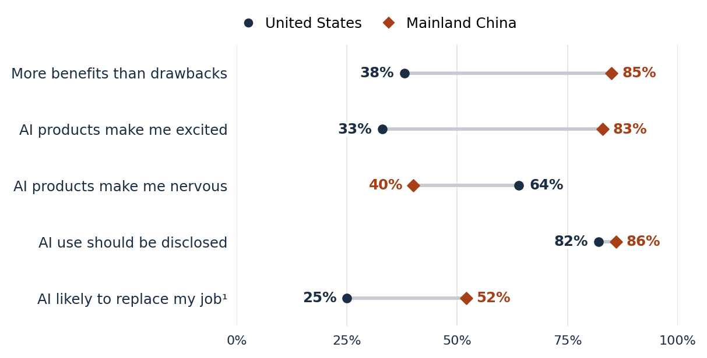

[Return to the essay](./)

[Public opinion](#public-opinion) · [Communities and authorship](#communities) · [The U.S. and China](#comparison) · [Model capability](#capability) · [Energy and water](#environment) · [Ego and identity](#identity) · [Paid time and apprenticeships](#work) · [Competition and engineering](#competition)

## How many people oppose what? {#public-opinion}

Rutgers-led U.S. quota surveys found that the share reporting *anger* about AI rose from 19% in late 2024 to 30% in summer 2026. In the later wave, 48% of daily users also reported worry. CBS News/YouGov asked about a policy choice in September 2026. Some 43% wanted U.S. AI companies to slow development and 12% wanted them to stop. Counting both groups as opponents of the technology would misstate the result. [Rutgers, sample and results](https://www.rutgers.edu/news/americans-use-artificial-intelligence-they-dont-want-it-charge) · [CBS News/YouGov](https://www.cbsnews.com/news/will-a-i-harm-humans-opinion-poll/)

In the October 19–November 3 SSRS election survey, 57% of the 39,938 U.S. House voters asked about AI expected it to do more harm than good to society and 24% expected more good. On November 5, YouGov found 40% negative and 35% positive among 1,797 U.S. adults. The samples, questions and answer choices differ, so subtracting these results would tell us little about a change in sentiment. [SSRS voter poll via ABC News](https://abcnews.com/Elections/polls-2026-us-house-election-results-analysis) · [YouGov, November 5](https://yougov.com/en-us/daily-results/20261105-415fe-2)

| U.S. comparison | What people actually said |
|:--------------|:--------------------------------------------------------------|
| **Age** | In Pew’s February survey of 5,119 adults, 48% of people under 30 expected a negative impact on society over 20 years, against 35% of those 65 and older. Yet 66% of the younger group had tried a chatbot, against 23% of the older group. On a different question in October–November, 75% of adults 65+ expressed concern, compared with 64% of those 18–34. The age ranking changes with the question. [Pew](https://www.pewresearch.org/internet/2026/06/17/how-opinions-and-use-of-ai-differ-by-age/) · [Americans on AI](https://www.americanson.ai/groups/) |
| **Gender** | On that same 20-year Pew question, 43% of women and 36% of men expected a negative societal impact. The gap was bigger at the optimistic end, where 22% of men and 11% of women expected a positive impact. [Pew](https://www.pewresearch.org/internet/2026/06/17/the-gender-gap-in-ai/) |
| **Race and ethnicity** | On the same question, 43% of White, 36% of Hispanic, 35% of Black and 24% of English-speaking Asian adults anticipated a negative impact. The last figure describes a U.S. survey group. It tells us nothing by itself about people living in mainland China. [Pew’s categories and results](https://www.pewresearch.org/internet/2026/06/17/racial-and-ethnic-differences-in-how-adults-use-and-view-ai/) |
| **Education and income** | The October 22–November 8 tracker found the highest concern among people with some college (74%), followed by college graduates (70%) and those with high school or less (65%). Concern also peaked in the middle income bracket, $50,000 to under $100,000 (74%). [Americans on AI](https://www.americanson.ai/groups/) · [Sampling method](https://www.americanson.ai/methodology/) |
| **Politics** | In 2023, Republicans and Republican leaners were more likely than Democrats and Democratic leaners to feel more concerned than excited about AI, 59% to 46%. By June 2026, Democrats led **56% to 49%**. [Pew’s repeated question](https://www.pewresearch.org/short-reads/2026/09/16/democrats-are-now-more-worried-than-republicans-about-ai-and-its-impact-on-jobs/) |

**Occupation.** In GDC’s voluntary survey of over 2,300 game-industry workers, 52% saw a negative impact on the industry, including 64% in visual and technical art, 63% in design and narrative, and 59% in game programming. In Stack Overflow’s separate international survey, 62% viewed using AI tools in their own development work favorably. A person can consistently hold both views. None of these group averages establishes an individual’s motives. [GDC](https://gdconf.com/article/gdc-2026-state-of-the-game-industry-reveals-impact-of-layoffs-generative-ai-and-more/) · [Stack Overflow](https://survey.stackoverflow.co/2026/ai/data/ai-sentiment)

## Communities, authorship and prior research {#communities}

On November 18, Jinjiang described a timed quiz on a work’s contents as one proposed way for an author to corroborate authorship. Since February 2025, 3,781 submissions had failed its AI screening for a contract. The platform supplied neither the number screened nor the false-positive rate. The Reddit artist’s account of being asked for a time-lapse is a personal report. [Artist’s account](https://www.reddit.com/r/ArtistLounge/comments/1j484zt/) · [Jinjiang’s announcement, in Chinese](https://bbsapi.jjwxc.net/showmsg.php?board=17&id=2346443&page=1)

In a November 20 r/antiai thread, one commenter welcomed medical and scientific advances while expressing disgust at AI art. Moderators of r/AskHistorians treat generated answers as plagiarism. A commenter in r/Blind described using image descriptions to browse Instagram, while others wanted senders to describe their own pictures. Moderation, membership and voting all affect which views a visitor sees. These cases document motives and uses with no population denominator. [r/antiai](https://www.reddit.com/r/antiai/comments/1y1ehfg/is_this_sub_even_antiai_anymore/) · [r/AskHistorians](https://www.reddit.com/r/AskHistorians/comments/1udjw9s/rules_roundtable_xxiv_plagiarism_integrity_and/) · [r/Blind](https://www.reddit.com/r/Blind/comments/1st4adg/people_sending_blind_people_pictures/)

Pessianzadeh and colleagues classified 230,576 posts from 39 subreddits in 2022–25. Trust and distrust were close overall. Technical performance mattered to both. Fullwood and colleagues intentionally selected an anti-AI forum and coded 363 posts. Mockery of AI users or defenders was the most frequent theme. [Reddit corpus, *Transactions of the ACL*](https://aclanthology.org/2026.tacl-1.74/) · [*Rage against machine learning*](https://www.open-access.bcu.ac.uk/17114/)

Liao and Lee compared discussions on Reddit, Quora and Zhihu. A separate *Acta Psychologica* study of Weibo posts about AI art found slightly more negative than positive sentiment, with copyright, expression and displacement among the concerns. These studies examine selected platforms or creative fields. [Reddit, Quora and Zhihu study](https://doi.org/10.1007/978-3-031-94171-9_33) · [Weibo art study](https://pubmed.ncbi.nlm.nih.gov/41421104/)

## Comparing American and Chinese sentiment {#comparison}

Ipsos asked the same questions in both countries in March–April 2026. The Chinese sample was 50 percentage points more likely to be excited by AI products and 27 points more likely to expect replacement of their current job within five years. Requiring disclosure drew support from 86% in China and 82% in the U.S. These are separate group totals. Individual responses would be needed to measure how often optimism and fear coexisted in the same person. [Ipsos AI Monitor 2026, pp. 16, 20, 26](https://www.ipsos.com/sites/default/files/ct/news/documents/2026-06/Ipsos-AI-Monitor-2026.pdf)

<figure>
  
  <figcaption>Five separate questions in the same Ipsos survey, March 20–April 3, 2026. ¹ The job question asked about the next five years. Each dot is the share agreeing or, for replacement, answering “likely.” About 1,000 respondents per country. The Chinese online sample skews urban, educated and affluent. <a href="https://www.ipsos.com/sites/default/files/ct/news/documents/2026-06/Ipsos-AI-Monitor-2026.pdf">Question wording, country tables and sampling notes</a>.</figcaption>
</figure>

Among AI-aware adults in a Gallup survey published in September, 93% in China and 36% in the U.S. said AI would mostly help their country. In parallel surveys fielded in 2023, 67% in China and 27% in the U.S. expected AI mostly to benefit people over 20 years. A mixed-mode 2024 Chinese national survey of 15,149 adults aged 18–69 found that 48.4% reported equal hope and worry. Rural respondents were more likely to think AI could replace their current or desired occupation than urban respondents (48.7% versus 38.1%). [Gallup, including the awareness filter](https://news.gallup.com/poll/714593/optimism-globally-widespread-despite-uneven.aspx) · [Li’s U.S.–China comparison](https://doi.org/10.1111/1758-5899.70105) · [Chinese survey, fielded in 2024](https://www.crsp.org.cn/zgkpyjsgb/xsky/yjly/kxszpg/art/2025/art_749368282.html)

Ipsos China published its study of 1,500 workplace respondents on November 20, 2026. Asked whether AI could do at least half their work, 21% thought it could already and 46% expected it could within three years. Of this sample, 83% were 25–45. Reported tools included Doubao (71%), DeepSeek (45%) and Qwen (40%), with multiple choices allowed. Estimates of task coverage do not estimate the number of jobs lost. [Ipsos China, survey and sample composition](https://www.ipsos.com/zh-cn/tixiaoyujiaolubingcundezhichangaishidai)

## What the strongest models can do {#capability}

As of November 23, 2026, Epoch’s capabilities index gave Claude Fable 5.2 and GPT-6.2 Astra 173 points each and Kimi K3.1 Pro 161. On Artificial Analysis’s October test of 70 scientific-computing tasks, GPT-6 Astra completed 63% and Kimi K3.1 Pro 34%. Kimi led a separate terminal-use benchmark at 67%. These results substantiate an American frontier advantage on the cited science tasks. They also show why the answer can change with the assignment. [Epoch’s frontier leader](https://epoch.ai/models/claude-fable-5-2) · [Kimi’s scores](https://epoch.ai/models/kimi-k3-1-pro) · [Artificial Analysis, tasks and settings](https://artificialanalysis.ai/articles/artificial-analysis-intelligence-index-v5/)

In the November 13–16 Economist/YouGov poll of U.S. citizens, 24% said the U.S. led in AI, 27% picked China, 20% said they were even and 29% were unsure. The spring cross-national poll predates the models benchmarked in the fall. To isolate capability’s effect on attitudes, randomly vary the quality of an identical work sample, independently vary its purported country of origin, and ask both whether a respondent would use it and whether their employer should be able to use it to replace them. [Economist/YouGov, question 34](https://d3nkl3psvxxpe9.cloudfront.net/documents/econTabReport_oFHY5oh.pdf#page=84)

## Electricity, water and the bill {#environment}

In a September 2026 AP-NORC/EPIC release, 53% of U.S. adults said they were extremely or very concerned about AI’s environmental effects, up from 41% in 2025. A separate October probability survey of 2,980 Americans found 71% had no trust in large technology companies to act in society’s best interest on data-center development. Environmental concern and distrust of a developer can overlap. Neither answer establishes that the respondent wants AI development stopped. [AP-NORC/EPIC](https://apnorc.org/projects/americans-are-increasingly-concerned-about-the-environmental-consequences-of-ai/) · [USC Understanding America Study](https://climatecenter.usc.edu/wp-content/uploads/2026/11/Electric-Futures_-AI-Data-Centers-and-Trust-Poll-Release.pdf)

The IEA’s *World Energy Outlook 2026*, published November 19, puts global data-center electricity demand at just under 500 TWh, around 1.7% of the world total. It estimates 885 billion litres of associated water consumption in 2025 across cooling, electricity, chip manufacturing and primary energy supply, including 240 billion litres used directly in data centers. Around 30% of existing and planned data-center capacity lies in areas of high water stress. These are sector-wide estimates. They cannot tell us the footprint of an individual AI query. [IEA, *World Energy Outlook 2026*, box 1.10 and figure 3.21](https://www.iea.org/files/9bd739f6-e4c8-4d09-902b-4e1eb7eb083f/WorldEnergyOutlook2026.pdf)

For a particular project, useful evidence includes the water source, water consumed during the hottest months, which generators meet the additional load, and who guarantees payment for the grid connection. A plant drawing on fossil generation at peak hours and a plant using otherwise curtailed clean power make different emissions claims. Ohio’s utilities commission ordered AEP Ohio to introduce a data-center tariff in July 2025 to protect other customers against infrastructure costs when projected demand fails to materialize. That is a concrete instance of the cost question voters can reasonably ask. [Public Utilities Commission of Ohio](https://puco.ohio.gov/news/puco-orders-aep-ohio-to-create-data-center-specific-tariff) · [IEA, electricity supply for data centres](https://www.iea.org/reports/energy-and-ai/energy-supply-for-ai)

## Ego, usefulness and the mirror {#identity}

A three-wave study of 443 full-time employees recruited through social networks found that greater perceived replacement risk was associated with weaker professional identity (regression coefficient −0.26), lower perceived meaning at work (−0.22), and greater job insecurity (+0.64). These are associations on survey scales. The study did not measure public hostility or identify the share of critics motivated by wounded pride. In a separate conference study based on 52 interviews in creative industries, researchers found that workers could feel their identity threatened and still engage with AI. [Three-wave workplace study, tables 4–5](https://www.frontiersin.org/journals/psychology/articles/10.3389/fpsyg.2026.1922666/full) · [Aufricht and Kammerlander, interview study](https://doi.org/10.5465/AMPROC.2025.14401abstract)

A 298-person study found that narcissism, Machiavellianism and psychopathy together added less than one percentage point to the variation explained in AI attitudes. Agreeableness predicted more favorable views and conspiratorial beliefs less favorable ones. The full model explained 14%. In a separate study of 509 undergraduates, cautious users reported more verification than heavy users, scored highest on openness and scored higher than moderate users on enjoyment of effortful thought. In Gallup’s Gen Z survey, 49% described themselves as curious about AI and 31% as angry. These measures provide no basis for inferring someone’s character or appetite for learning from criticism of a tool. [Personality study, Table 7](https://pmc.ncbi.nlm.nih.gov/articles/PMC10844202/) · [Liss and Schweitzer, online ahead of the February 2027 issue](https://doi.org/10.1016/j.paid.2026.114132) · [Gallup’s Gen Z survey](https://news.gallup.com/poll/708224/gen-adoption-steady-skepticism-climbs.aspx)

Shannon Vallor argues that models reflect historical human practices through their training material. Model behavior can also alter a user’s judgment. Cheng and colleagues found that 11 models affirmed users’ actions 49% more often than human comparators. In three preregistered experiments with 2,405 participants, a flattering interaction increased conviction and reduced stated willingness to repair interpersonal conflicts. The experiment measured immediate responses. [Vallor](https://academic.oup.com/book/56292) · [Cheng and colleagues, *Science*](https://doi.org/10.1126/science.aec8352)

**How to test the essay’s wager.** Hold output quality and pay constant. Vary whether workers get credit for a solution, whether colleagues still consult them and who must verify the output. Measure willingness to use the assistant, checking time and actual error rates. If support barely changes when recognition or the burden of checking changes, the explanation in the essay loses force.

## Who controls the hours saved? {#work}

Labor historian David Montgomery traced the U.S. term *aristocracy of labor* to relatively privileged skilled workers. Applying 工人贵族 to salaried professionals today is an analogy. In May 2025 the U.S. median annual software-developer wage was $135,980, compared with $50,980 across occupations. The 2025 Occupational Requirements Survey classified 65.8% of software developers, 18.5% of workers overall and 0.7% of electricians as having a self-paced workload. A worker’s ability to set the pace says little about total effort. [David Montgomery on the term’s history](https://www.dol.gov/general/aboutdol/history/chapter3) · [BLS wages](https://www.bls.gov/ooh/computer-and-information-technology/software-developers.htm) · [BLS work requirements, 2025](https://www.bls.gov/news.release/archives/ors_01162026.htm)

A U.S. study published in 2018 found 21.7% experienced involuntary downtime daily. Respondents averaged 69 idle minutes across their previous five workdays. In the OECD’s 2026 report, 879 Chinese listed firms reporting training hours averaged 55 hours per employee in 2024, compared with about 24 at 467 reporting U.S. firms. These sources cannot count people who simultaneously earn a high wage, do little work and learn a great deal. [Brodsky and Amabile](https://dash.harvard.edu/entities/publication/73120379-0cc0-6bd4-e053-0100007fdf3b) · [OECD, figure 4.2](https://www.oecd.org/en/publications/asia-capital-markets-report-2026_08f87bed-en/full-report/human-capital_ae6dfee6.html)

In a randomized trial of 52 mostly junior developers learning an unfamiliar Python library, the AI-assisted group scored 50% on an immediate quiz, compared with 67% among those coding by hand. A longer test could allow some teams to spend saved hours on paid practice while others face higher quotas, then compare their ability to diagnose a new problem unaided months later. [Shen and Tamkin, experiment and limitations](https://www.anthropic.com/research/AI-assistance-coding-skills)

## Can China gain orders and lose an advantage? {#competition}

On November 3, 2026, voters favored limits on data-center development in 46 of 47 local ballot contests tracked by Ballotpedia. Five imposed outright bans. Others were temporary, advisory or project-specific. These were places where a dispute got onto the ballot, and data centers also serve non-AI workloads. To test whether China benefits, track whether the affected capacity is delayed, canceled, replaced elsewhere in America or actually moved abroad. [Ballotpedia’s measure-by-measure results](https://ballotpedia.org/Data_center-related_ballot_measures,_2026)

Stanford’s AI Index recorded $285.9 billion of U.S. private AI investment in 2025 against $12.4 billion in China. The measure excludes much Chinese state financing and predates the ballots. Powered capacity, production deployments and fulfilled orders would give a better test of a change in relative industrial position. [Stanford AI Index, investment figures and caveat](https://hai.stanford.edu/ai-index/2026-ai-index-report)

China’s official statistics count 1.57 million engineering graduates from regular undergraduate programs in 2022. The wage-cost mechanism in the essay has simple arithmetic. A hypothetical job taking 100 hours at $60 an hour in the U.S. and $20 in China gives the Chinese firm a $4,000 labor-cost advantage. If identical tools let both deliver accepted work in 20 hours, the advantage shrinks to $800. The illustration assumes equal software charges, quality, access and fixed demand. It makes no forecast of national wages or employment. [Chinese Ministry of Education, graduates by discipline](https://www.moe.gov.cn/jyb_sjzl/moe_560/2022/quanguo/202401/t20240110_1099511.html)

The countervailing advantage is access to physical systems, suppliers and customers. In 2025 China installed 354,226 industrial robots and the U.S. installed 38,428. This measures the scale of factory automation. In three randomized trials involving 4,867 software developers, an AI coding assistant increased completed tasks by an estimated 26%, with larger gains among less experienced developers. Faster task completion alone tells us little about long-run demand for junior labor. [International Federation of Robotics](https://ifr.org/img/worldrobotics/Executive_Summary_WR_2026_-_Industrial_Robots.pdf) · [Cui and colleagues, field experiments](https://www.microsoft.com/en-us/research/publication/the-effects-of-generative-ai-on-high-skilled-work-evidence-from-three-field-experiments-with-software-developers/)

A November working paper using 1.25 billion job postings and 154 million employment records across 41 countries found the junior share fell at foreign affiliates of AI-adopting companies mainly because senior employment grew. A Chinese firm study found that when AI substituted for tasks, posted wages and labor’s share of income fell even as productivity rose. To distinguish harm to a profession from a gain to an exporter, compare matched specialties across countries on orders, accepted output, defects, entry hiring and wage premiums. Rising junior hiring and pay in the most exposed firms would count against the prediction in the essay. [41-country working paper](https://digitaleconomy.stanford.edu/app/uploads/2026/11/Does-AI-Change-Labor-Demand.pdf) · [Chinese firm evidence](https://qks.sufe.edu.cn/J/CJYJ/Article/Details/A0qidEfPM4-Vnng-E1Pa-AYZg-JnITbJD6pRLb)

*Claude Opus 5.5 (Extra) assisted with the original research review. Gemini Neon (High) finalized the main essay. The cost example and the proposed tests are the author’s analysis.*

[Return to the essay](./)
