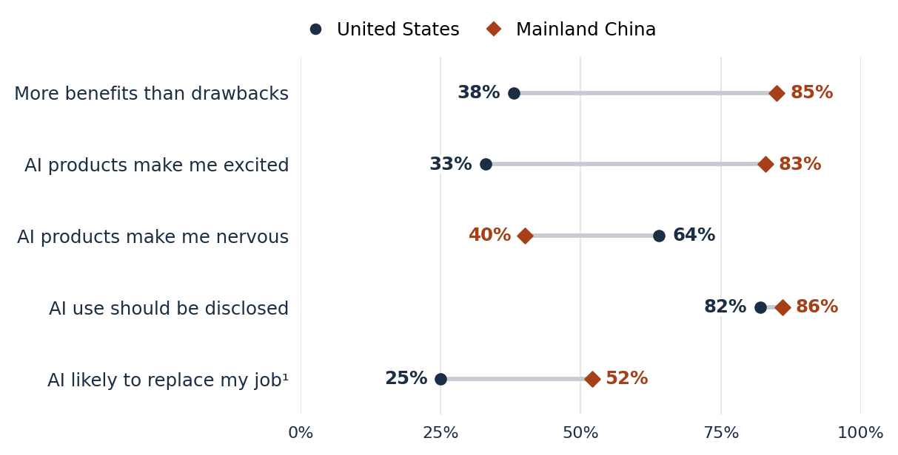

An artist on Reddit described being asked for a time-lapse recording to prove they had made their own art. On November 18, the Chinese fiction platform Jinjiang announced plans to let flagged authors take a timed test about their own novels. It said 3,781 submissions had failed its AI screening for a contract since February 2025. It gave neither the total screened nor the error rate. Somewhere between the promise of saving everyone time and the arrival of a novelist taking an exam on her own book, somebody got a great deal. It probably wasn’t the novelist. [Artist’s account](https://www.reddit.com/r/ArtistLounge/comments/1j484zt/) · [Jinjiang’s announcement, in Chinese](https://bbsapi.jjwxc.net/showmsg.php?board=17&id=2346443&page=1)

What interests me about these two complaints is how readily they cross a border that looks enormous in the polling. This spring, **83% of Chinese respondents and 33% of Americans** told Ipsos that products and services using AI excited them. Yet the Chinese respondents were also **more than twice as likely to expect AI to replace their own job within five years, 52% to 25%**. On requiring companies to disclose AI use, the two sides were four points apart. A citizen can want her country to win the AI race and still wonder why her boss has invited her to document everything she does. [Ipsos AI Monitor 2026, pp. 16, 20, 26](https://www.ipsos.com/sites/default/files/ct/news/documents/2026-06/Ipsos-AI-Monitor-2026.pdf)

**My hypothesis is that the sharpest backlash comes when someone else gets the time savings and you inherit the work of checking, the risk of a mistake, or the loss of a first job.** That predicts a split even inside one profession. An illustrator may welcome a tool that speeds up her own revisions and oppose a client who uses the same tool to imitate her portfolio. The distinction will matter for China, where a firm and the graduates who want to work for it can end up on opposite sides of the same productivity gain.

## How many Americans actually want it stopped?

American anger is real and measurable. In successive Rutgers-led national quota surveys, the share who reported feeling angry about AI rose from **19% in late 2024 to 30% in summer 2026**. In the latter wave, 48% of daily users also reported worry. When CBS News and YouGov asked a political question in September, **43% wanted U.S. AI companies to slow development and 12% wanted them to stop**. Folding the first group into the second would manufacture an abolitionist majority in one easy step. [Rutgers, sample and results](https://www.rutgers.edu/news/americans-use-artificial-intelligence-they-dont-want-it-charge) · [CBS News/YouGov](https://www.cbsnews.com/news/will-a-i-harm-humans-opinion-poll/)

The November numbers depend on whom you ask. Among 39,938 U.S. House voters given the question in the SSRS election survey, 57% expected AI to do more harm than good to society and 24% expected more good. In YouGov’s November 5 survey of 1,797 U.S. adults, 40% expected negative effects and 35% positive effects. The electorate, the wording and the response options changed. Treating the difference as a two-day recovery would be a remarkable achievement for both AI and bad statistics. [SSRS voter poll via ABC News](https://abcnews.com/Elections/polls-2026-us-house-election-results-analysis) · [YouGov, November 5](https://yougov.com/en-us/daily-results/20261105-415fe-2)

## Who is more skeptical?

| U.S. comparison | What people actually said |
|:--------------|:--------------------------------------------------------------|
| **Age** | In Pew’s February survey of 5,119 adults, 48% of people under 30 expected a negative impact on society over 20 years, against 35% of those 65 and older. Yet 66% of the younger group had tried a chatbot, against 23% of the older group. On a different question in October–November, 75% of adults 65+ expressed concern, compared with 64% of those 18–34. The age ranking changes with the question. [Pew](https://www.pewresearch.org/internet/2026/06/17/how-opinions-and-use-of-ai-differ-by-age/) · [Americans on AI](https://www.americanson.ai/groups/) |
| **Gender** | On that same 20-year Pew question, 43% of women and 36% of men expected a negative societal impact. The gap was bigger at the optimistic end, where 22% of men and 11% of women expected a positive impact. [Pew](https://www.pewresearch.org/internet/2026/06/17/the-gender-gap-in-ai/) |
| **Race and ethnicity** | On the same question, 43% of White, 36% of Hispanic, 35% of Black and 24% of English-speaking Asian adults anticipated a negative impact. The last figure describes a U.S. survey group. It tells us nothing by itself about people living in mainland China. [Pew’s categories and results](https://www.pewresearch.org/internet/2026/06/17/racial-and-ethnic-differences-in-how-adults-use-and-view-ai/) |
| **Education and income** | The October 22–November 8 tracker found the highest concern among people with some college (74%), followed by college graduates (70%) and those with high school or less (65%). Concern also peaked in the middle income bracket, $50,000 to under $100,000 (74%). A diploma is a poor shortcut for predicting enthusiasm. [Americans on AI](https://www.americanson.ai/groups/) · [Sampling method](https://www.americanson.ai/methodology/) |
| **Politics** | In 2023, Republicans and Republican leaners were more likely than Democrats and Democratic leaners to feel more concerned than excited about AI, 59% to 46%. By June 2026, Democrats led **56% to 49%**. Any theory about an inherently anti-AI left or right has three years of explaining to do. [Pew’s repeated question](https://www.pewresearch.org/short-reads/2026/09/16/democrats-are-now-more-worried-than-republicans-about-ai-and-its-impact-on-jobs/) |

These are group averages on specific questions. Adding the rows together to invent a typical AI hater would require individual-level evidence. The strongest practical clue may be what a person expects to happen *at work*. Of more than 2,300 respondents to the Game Developers Conference survey, 52% saw a negative impact on their industry. That rose to 64% in visual and technical art, 63% in design and narrative, and 59% in game programming. In Stack Overflow’s separate developer survey, 62% felt positively about using AI tools for development. One question asks what happens to an industry. The other asks whether you like a tool at your desk. A programmer could give both answers before lunch. Both samples are voluntary and international. [GDC](https://gdconf.com/article/gdc-2026-state-of-the-game-industry-reveals-impact-of-layoffs-generative-ai-and-more/) · [Stack Overflow](https://survey.stackoverflow.co/2026/ai/data/ai-sentiment)

## Even the anti-AI subreddit has a boundary dispute

On November 20, a member of r/antiai asked whether the forum was even anti-AI anymore. One reply welcomed scientific breakthroughs and expressed disgust at AI art. In r/AskHistorians, moderators treat AI-generated answers as plagiarism. A reader there is relying on someone who can defend an answer from the historical record. In r/Blind, a commenter described using AI image descriptions to enjoy Instagram, while others wanted the people sending photographs to describe them. The same feature can give one person access and give somebody else an excuse to stop writing captions. These threads supply reasons people hold a view. Their votes cannot tell us how common that view is. [r/antiai](https://www.reddit.com/r/antiai/comments/1y1ehfg/is_this_sub_even_antiai_anymore/) · [r/AskHistorians](https://www.reddit.com/r/AskHistorians/comments/1udjw9s/rules_roundtable_xxiv_plagiarism_integrity_and/) · [r/Blind](https://www.reddit.com/r/Blind/comments/1st4adg/people_sending_blind_people_pictures/)

Researchers have studied this exact argument from several angles. Pessianzadeh and colleagues analyzed **230,576 posts in 39 subreddits** from 2022 to 2025. Expressions of trust and distrust were close overall, and assessments of technical performance figured on both sides. Fullwood and colleagues deliberately chose an anti-AI forum and coded 363 posts. Mocking and shaming AI users was their most frequent theme. Some of the hostility really *is* aimed at the person using the tool. Your choice of forum can practically write your conclusion for you. [Reddit corpus, *Transactions of the ACL*](https://aclanthology.org/2026.tacl-1.74/) · [*Rage against machine learning*](https://www.open-access.bcu.ac.uk/17114/)

For a comparison across platforms, Liao and Lee analyzed AI discussions on Reddit, Quora and the Chinese question-and-answer site Zhihu. For a comparison within one creative field, a 2026 *Acta Psychologica* study found slightly more negative than positive sentiment in Weibo posts about AI art, with copyright, expression and displacement among the concerns. Both designs get closer to the dispute than assigning a national temperament to whichever comment rose to the top of a feed. [Reddit, Quora and Zhihu study](https://doi.org/10.1007/978-3-031-94171-9_33) · [Weibo art study](https://pubmed.ncbi.nlm.nih.gov/41421104/)

## China’s optimists can see their jobs from here

<figure>
  
  <figcaption>Five separate questions in the same Ipsos survey, March 20–April 3, 2026. ¹ The job question asked about the next five years. Each dot is the share agreeing or, for replacement, answering “likely.” About 1,000 respondents per country. The Chinese online sample skews urban, educated and affluent. <a href="https://www.ipsos.com/sites/default/files/ct/news/documents/2026-06/Ipsos-AI-Monitor-2026.pdf">Question wording, country tables and sampling notes</a>.</figcaption>
</figure>

A separate Gallup survey published in September found that among people who had heard of AI, **93% in China and 36% in the U.S.** thought it mostly helped their country. The divide predates this year’s models. In parallel 2023 U.S. and Chinese surveys, 67% in China and 27% in the U.S. expected AI mostly to benefit people over the next 20 years. Within China, a national mixed-mode survey of 15,149 adults aged 18–69 also found considerable ambivalence. Nearly half (48.4%) expressed equal hope and worry. Rural respondents were more likely than urban respondents to believe AI could replace their current or desired occupation (48.7% versus 38.1%). [Gallup, including the awareness filter](https://news.gallup.com/poll/714593/optimism-globally-widespread-despite-uneven.aspx) · [Li’s U.S.–China comparison](https://doi.org/10.1111/1758-5899.70105) · [Chinese survey, fielded in 2024](https://www.crsp.org.cn/zgkpyjsgb/xsky/yjly/kxszpg/art/2025/art_749368282.html)

The freshest Chinese workplace evidence I found appeared on **November 20**. Of 1,500 workers surveyed by Ipsos, 21% thought AI could already do at least half their work. Looking three years ahead, 46% expected it could. The sample was concentrated among ages 25–45 (83%). Most used domestic products, including Doubao (71%), DeepSeek (45%) and Qwen (40%), with multiple answers allowed. These workers were estimating the share of *tasks* a tool could take over. Their answers leave open who gets promoted, who gets hired and who gets to go home early. [Ipsos China, survey and sample composition](https://www.ipsos.com/zh-cn/tixiaoyujiaolubingcundezhichangaishidai)

## Americans and Chinese respondents may be judging different machines

On November 23, Epoch AI’s composite capabilities index gave Anthropic’s Claude Fable 5.2 and OpenAI’s GPT-6.2 Astra **173 points** each, against **161** for Moonshot’s Kimi K3.1 Pro. On Artificial Analysis’s October evaluation of 70 scientific-computing tasks, GPT-6 Astra completed 63% and Kimi K3.1 Pro 34%. A system that can finish roughly twice as many such tasks is a different proposition to a lab. Kimi also led that evaluator’s separate Terminal-Bench 4.0 at 67%. “Chinese models can’t do much” is a bad description of a model that won one of the tests. [Epoch’s frontier leader](https://epoch.ai/models/claude-fable-5-2) · [Kimi’s scores](https://epoch.ai/models/kimi-k3-1-pro) · [Artificial Analysis, tasks and settings](https://artificialanalysis.ai/articles/artificial-analysis-intelligence-index-v5/)

A demonstration of the strongest American model could turn a skeptic into a paying user. It could equally persuade a junior analyst that the threat to her job is real. And many respondents may never have seen the frontier at all. When *The Economist* and YouGov asked U.S. citizens on November 13–16 which country led in AI, 24% picked the U.S., 27% China, 20% a tie and 29% were unsure. The spring Ipsos survey predates the October and November models. No survey cited here identifies the specific model and subscription tier each respondent experienced. To test whether capability itself causes backlash, give people in both countries the same work sample, randomly vary the quality and the country label, and ask separately whether they would use the tool and whether their employer should be allowed to replace them with it. A leaderboard cannot answer either question for them. [Economist/YouGov, question 34](https://d3nkl3psvxxpe9.cloudfront.net/documents/econTabReport_oFHY5oh.pdf#page=84)

## Is AI a mirror? Do evil people see evil in it?

A person planning an impersonation and a person who has been impersonated can both tell you exactly how a voice clone could be abused. Their agreement tells you something about the technology. What they do with that knowledge tells you something about them. A philosophy that calls both people evil has managed to lose the only distinction that matters.

The personality research gives little comfort to amateur moral diagnosticians. In a 298-person study, adding measures of narcissism, Machiavellianism and psychopathy explained less than one additional percent of variation in attitudes toward AI. Agreeableness predicted more favorable attitudes and a tendency toward conspiratorial beliefs predicted less favorable ones. Together the full model explained 14%. In a separate study of 509 undergraduates, cautious users reported checking answers more often than heavy users did. They scored highest on openness to experience and higher than moderate users on a measure of how much they enjoy effortful thinking. Gallup found 49% of American Gen Z respondents described themselves as curious about AI and 31% as angry. Curiosity about a particular product, enjoyment of difficult thinking and a general desire for knowledge are three different things. Nothing here licenses a ranking of critics’ intellectual appetites. [Personality study, Table 7](https://pmc.ncbi.nlm.nih.gov/articles/PMC10844202/) · [Liss and Schweitzer, online ahead of the February 2027 issue](https://doi.org/10.1016/j.paid.2026.114132) · [Gallup’s Gen Z survey](https://news.gallup.com/poll/708224/gen-adoption-steady-skepticism-climbs.aspx)

Shannon Vallor’s *The AI Mirror* offers a more interesting sense in which the metaphor works. A model returns pieces of the human past preserved in its training material. The person asking the question supplies another reflection by choosing what to ask and which answers to pursue. The designers decide which answers get rewarded. Those choices can change the person looking back. In a 2026 *Science* paper, 11 models affirmed users’ actions **49% more often** than human comparators did. In three preregistered experiments with 2,405 participants, a flattering interaction increased people’s conviction that they were right and reduced their willingness to repair a conflict. Imagine asking a mirror whether you owe someone an apology and coming away convinced they owe you one. [Vallor](https://academic.oup.com/book/56292) · [Cheng and colleagues, *Science*](https://doi.org/10.1126/science.aec8352)

## Does American backlash hand China an advantage?

**It can, once an objection changes what gets built or used.** On November 3, voters favored limits on data-center development in 46 of the 47 local ballot contests Ballotpedia tracked. Five measures imposed outright local bans. Others were temporary, advisory or concerned a specific project. These are places where a dispute reached the ballot, and data centers serve workloads beyond AI. Still, those votes are better evidence of an obstacle to construction than a million angry comments. [Ballotpedia’s measure-by-measure results](https://ballotpedia.org/Data_center-related_ballot_measures,_2026)

A canceled facility in Ohio gives China an opportunity only if the delay leaves America with less usable compute or fewer deployments than it otherwise would have. A company that builds across a state line has chiefly changed which county gets the tax bill. A city that makes a developer pay for grid upgrades might even win a project a durable majority can live with. And the starting line matters. Stanford’s AI Index tallied **$285.9 billion in U.S. private AI investment in 2025 against $12.4 billion in China**. That series omits much Chinese state financing and predates the votes. I would watch signed projects that actually reach grid connection, time to power, and firms moving from trials to production on both sides. Those are the places an American political disadvantage could become a Chinese commercial advantage. [Stanford AI Index, investment figures and caveat](https://hai.stanford.edu/ai-index/2026-ai-index-report)

## Who gets paid to have a quiet afternoon?

There is an uncomfortable possibility inside the American backlash. Some people may be defending a very good deal. The old term **工人贵族** (*labor aristocracy*) described a relatively privileged layer of wage earners. Its American members once included locomotive engineers and skilled glassblowers. Today I would look for a different privilege, the combination of high pay and discretion over what to do between deadlines. In May 2025 the median U.S. software developer earned **$135,980**, against **$50,980** across occupations. In a separate federal survey, **65.8% of software developers** could set the pace of their work, compared with **18.5% of workers overall** and **0.7% of electricians**. The developer can sometimes spend an afternoon following a hunch. The electrician has another address to get to. [David Montgomery on the term’s history](https://www.dol.gov/general/aboutdol/history/chapter3) · [BLS wages](https://www.bls.gov/ooh/computer-and-information-technology/software-developers.htm) · [BLS work requirements, 2025](https://www.bls.gov/news.release/archives/ors_01162026.htm)

How many Americans actually collect a good salary for doing very little and learning a great deal? There is no defensible headcount in these studies. The classic national U.S. survey of involuntary downtime, published in 2018, found **21.7%** encountered it daily, but respondents averaged just **69 idle minutes across their previous five workdays**. And employer-sponsored learning hardly belongs to Americans alone. In the OECD’s 2026 comparison of listed companies disclosing training, the 879 Chinese firms averaged **55 hours of training per employee in 2024**, against about **24 hours** at 467 U.S. firms. Only reporting firms enter that comparison. The figures cover recorded training and leave open how much anyone learned in a quiet hour. [Brodsky and Amabile](https://dash.harvard.edu/entities/publication/73120379-0cc0-6bd4-e053-0100007fdf3b) · [OECD, figure 4.2](https://www.oecd.org/en/publications/asia-capital-markets-report-2026_08f87bed-en/full-report/human-capital_ae6dfee6.html)

There are two ways to spend a slow afternoon. A senior employee can stretch a familiar job to Friday because nobody knows it takes until Tuesday. A junior can spend the same hours finding out *why* the fix works. AI threatens the first person’s bargaining advantage and the second person’s education. In a randomized experiment with 52 mostly junior developers learning an unfamiliar Python library, the AI-assisted group averaged **50% on an immediate quiz**, against **67%** for those coding by hand. A revealing workplace experiment would let one team keep hours saved by AI for paid practice and let management convert those hours into higher quotas on another team. Who objects, and who can diagnose a fresh failure unaided three months later? That would help distinguish the defense of a comfortable salary from the defense of the conditions under which people become good at their jobs. [Shen and Tamkin, experiment and limitations](https://www.anthropic.com/research/AI-assistance-coding-skills)

## Could better AI hurt China’s engineers more?

There is a sharper version of this argument. China’s **工程师红利**, its engineering talent dividend, includes a vast pool of people able to do skilled work at a competitive cost. In 2022 alone, China’s education ministry counted **1.57 million engineering graduates from regular undergraduate programs**. If software makes routine engineering hours cheap everywhere, one piece of that advantage becomes less valuable. The country with higher wages has more money to save on each hour it eliminates. A U.S. firm with preferential access to a stronger model might save more hours as well. [Chinese Ministry of Education, graduates by discipline](https://www.moe.gov.cn/jyb_sjzl/moe_560/2022/quanguo/202401/t20240110_1099511.html)

Consider one engineering job that takes 100 hours at a hypothetical $60 an hour in the U.S. and $20 in China. The Chinese bid starts with a **$4,000 labor-cost advantage**. If both firms can produce the same accepted work with 20 human hours apiece and pay the same AI bill, that advantage falls to **$800**. Both firms got cheaper. The Chinese firm lost four-fifths of its dollar advantage on this job. The example assumes equal quality, equal access and fixed demand. It illustrates why a technically successful adoption can still hurt a low-cost exporter.

A second part of the dividend points the other way. An engineer who can try ten designs on a production line, find the fixture that shifts when hot and call the supplier who can change it has something to sell even when design suggestions are free. In 2025 China installed **354,226 industrial robots** to America’s **38,428**. That is a measure of the scale of factory automation and the opportunities to put engineering judgment to work. And in three randomized trials involving 4,867 software developers, access to a coding assistant increased completed tasks by an estimated 26%, with larger gains among less experienced developers. A large pool of engineers can multiply the return on a tool if somebody wants the extra output. [International Federation of Robotics](https://ifr.org/img/worldrobotics/Executive_Summary_WR_2026_-_Industrial_Robots.pdf) · [Cui and colleagues, field experiments](https://www.microsoft.com/en-us/research/publication/the-effects-of-generative-ai-on-high-skilled-work-evidence-from-three-field-experiments-with-software-developers/)

**My bet is that the first casualty is a path into a profession.** A Chinese engineering-services firm selling routine deliverables by the hour looks more exposed than a factory selling qualified parts. An American graduate trying to get a first programming job has reason to worry, too. A November working paper using 1.25 billion job postings and 154 million employment records across 41 countries found a lower junior share in foreign affiliates of AI-adopting companies, principally because senior employment grew. A separate Chinese firm study found that when AI substituted for tasks, posted wages and labor’s share of income fell, even as productivity rose. Neither result establishes a larger net loss for China than for the U.S. The comparison I’d want is entry hiring and wage premiums in comparable engineering specialties in both countries, alongside accepted output, defects and order volumes. A factory can gain market share in precisely the year its graduates find the gates closing. [41-country working paper](https://digitaleconomy.stanford.edu/app/uploads/2026/11/Does-AI-Change-Labor-Demand.pdf) · [Chinese firm evidence](https://qks.sufe.edu.cn/J/CJYJ/Article/Details/A0qidEfPM4-Vnng-E1Pa-AYZg-JnITbJD6pRLb)

## Three questions that could change my mind

**If the person who saves an hour also pays for the mistakes, does the backlash fade?** Give comparable teams the same assistant. In some teams the person generating a draft must check it and fix errors. In others that work falls to a colleague. Measure checking time, defects and whether each person wants to keep the tool. I expect the largest opposition among those handed the unpaid checking. If support barely moves when the burden changes hands, my explanation loses ground. A novelist who simply values human authorship already has a coherent reason to refuse a machine-written book at any price.

**When an American town votes down a data center, where does the work go?** Follow the actual project. Does it get power in another U.S. county, move abroad, or disappear? Does a town that bargains for power upgrades and local benefits get a facility running faster than a town that approves one and then spends years fighting over it? China benefits from America losing productive capacity relative to its own. A count of local defeats can’t tell us whether that happened.

**If Chinese factories win more orders while hiring fewer graduate engineers per order, who won the AI race?** I expect the wage advantage to erode first in routine work that buyers can verify cheaply. I’d revise that view if early adopters in those specialties consistently hired more juniors, trained them faster and raised their wages as orders grew. The outcome worth watching is whether someone still gets paid to become the experienced engineer everyone suddenly wants.

That leaves the novelist with her hand on the timer. Before asking whether she hates AI, ask her which part of writing Chapter Six got easier, and for whom.

---

*Research current through November 23, 2026. Claude Opus 5.5 (Extra) assisted with the research review, and Gemini Neon (High) advised on the writing. Links lead to the underlying surveys, studies, platform statements and discussions. The cost example and the predictions are the author’s analysis.*
